# 기술적 분석 실제 브라우저 검증 보고서

검증일: 2026-11-14 (KST) · Chromium · `/chat` → 기술적 분석 에이전트

**판정: 올바른 실행 서버에 연결하면 주요 분석·OpenUI 차트 기능은 동작한다. 기존 로컬 연결 설정과 설명문 표시에는 개선 사항이 있다.**

실제 Yahoo Finance·실제 모델(OAuth proxy)·TA-Lib·Host OpenUI validator 경로를 사용했다. 네트워크 응답을 fixture로 대체하지 않았다. 시장 데이터의 진위나 투자 성과를 별도로 검증한 보고서는 아니다.

- 브라우저 시나리오 **12개: PASS 10 / WARN 1 / FAIL 1**. FAIL은 최초 로컬 연결 설정 검사다.
- 독립 fixture/mock 회귀 검사 **46/46 PASS**. 실제 서비스 검증과 별개다.
- 설명문 Markdown 원문 노출은 시나리오 수와 별도의 표시 결함으로 기록했다.
- PNG는 실제 화면 캡처이며 내부 채팅 스크롤 위치만 바꾸었다. 차트·답변·수치를 합성하거나 수정하지 않았다.

## 한눈에 보기

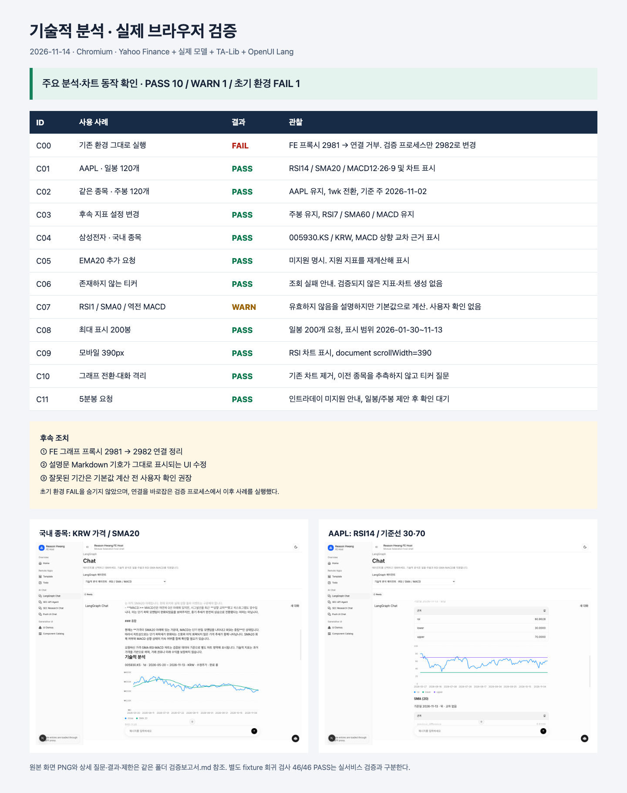

## 사용 사례별 결과

| ID | 사용 사례 | 결과 | 관찰 | PNG |
| --- | --- | --- | --- | --- |
| C00 | 기존 환경 그대로 실행 | FAIL | FE 프록시 2981 → 연결 거부. 검증 프로세스만 2982로 변경 | [캡처](00-original-config.png) |
| C01 | AAPL · 일봉 120개 | PASS | RSI14 / SMA20 / MACD12·26·9 및 차트 표시 | [캡처](01-aapl-daily-price-rsi.png) |
| C02 | 같은 종목 · 주봉 120개 | PASS | AAPL 유지, 1wk 전환, 기준 주 2026-11-02 | [캡처](02-aapl-weekly-price.png) |
| C03 | 후속 지표 설정 변경 | PASS | 주봉 유지, RSI7 / SMA60 / MACD 유지 | [캡처](03-custom-rsi7-sma60.png) |
| C04 | 삼성전자 · 국내 종목 | PASS | 005930.KS / KRW, MACD 상향 교차 근거 표시 | [캡처](04-samsung-macd-cross.png) |
| C05 | EMA20 추가 요청 | PASS | 미지원 명시. 지원 지표를 재계산해 표시 | [캡처](05-unsupported-ema.png) |
| C06 | 존재하지 않는 티커 | PASS | 조회 실패 안내. 검증되지 않은 지표·차트 생성 없음 | [캡처](06-invalid-ticker.png) |
| C07 | RSI1 / SMA0 / 역전 MACD | WARN | 유효하지 않음을 설명하지만 기본값으로 계산. 사용자 확인 없음 | [캡처](07-invalid-periods-warning.png) |
| C08 | 최대 표시 200봉 | PASS | 일봉 200개 요청, 표시 범위 2026-01-30~11-13 | [캡처](08-aapl-200-bars.png) |
| C09 | 모바일 390px | PASS | RSI 차트 표시, document scrollWidth=390 | [캡처](09-mobile-rsi.png) |
| C10 | 그래프 전환·대화 격리 | PASS | 기존 차트 제거, 이전 종목을 추측하지 않고 티커 질문 | [캡처](10-new-thread-clarification.png) |
| C11 | 5분봉 요청 | PASS | 인트라데이 미지원 안내, 일봉/주봉 제안 후 확인 대기 | [캡처](11-intraday-unsupported.png) |

## 주요 관측값

표시된 수치는 2026-11-14 조회 당시 결과이며 이후 데이터 수정·조회 시점에 따라 달라질 수 있다.

| 분석 | 기준일 | 종가 | RSI | SMA | MACD / Signal / histogram |
| --- | --- | --- | --- | --- | --- |
| AAPL 일봉, 기본 설정 | 2026-11-13 | 356.27 USD | 60.9028 (14) | 345.9147 (20) | 4.2090 / 3.2900 / 0.9191 |
| AAPL 주봉, 기본 설정 | 2026-11-02 | 342.11 USD | 63.6503 (14) | 325.1418 (20) | 15.1884 / 14.9214 / 0.2670 |
| AAPL 주봉, 설정 변경 | 2026-11-02 | 342.11 USD | 63.5283 (7) | 287.7368 (60) | 15.1884 / 14.9214 / 0.2670 |
| 삼성전자 일봉, 기본 설정 | 2026-11-13 | 206,000 KRW | 42.2751 (14) | 214,125 (20) | -10,760.6923 / -10,848.4271 / 87.7348 |

삼성전자 MACD 차이는 직전 -450.3665 → 현재 +87.7348로 바뀌었고 화면에 상향 교차로 표시됐다. AAPL은 선의 위/아래 위치와 교차 이벤트 없음을 구분했다. 주봉은 다음 월요일 이후 완료로 인정하는 기존 정책과 일치했다.

## 발견 사항과 후속 작업

1. **연결 설정 — 우선 수정 권장.** `.env`와 `.env.local`의 `LANGGRAPH_INTERNAL_API_URL`은 2981이었다. 그래프 실행 서버는 2982다. 최초 요청은 서버 로그에서 `ECONNREFUSED 127.0.0.1:2981`, thread 요청 500으로 확인했다. 최초 PNG는 요청 대기 시점 캡처다. 이번에는 셸 환경변수로 검증 FE만 2982에 연결했으며 기존 환경파일을 수정하지 않았다.
2. **설명문 Markdown 표시 — UI 결함.** 본문의 `##`, `**`, 표 구분자가 그대로 표시된다. 별도의 OpenUI 차트·표는 정상 렌더링된다. [설명문 PNG](01-aapl-daily-answer.png)에서 확인할 수 있다.
3. **잘못된 지표 기간 — 사용자 확인 권장.** 잘못된 값을 경고하지만 RSI14/SMA20/MACD12·26·9로 바꾸어 계산했다. 오류로 중단하거나 유효한 설정을 확인받는 UX가 더 명확하다. 이번 판정은 WARN이며 잘못된 기간 자체가 계산된 것은 아니다.
4. **EMA 요청 시 지원 지표 재출력.** EMA 미지원은 명확히 설명하지만 기존 RSI/SMA/MACD 차트를 다시 보여준다. EMA가 새로 추가됐다는 오해를 막는 현재 안내는 확인했다.

## PNG 갤러리

### AAPL 일봉: 설명·RSI·MACD

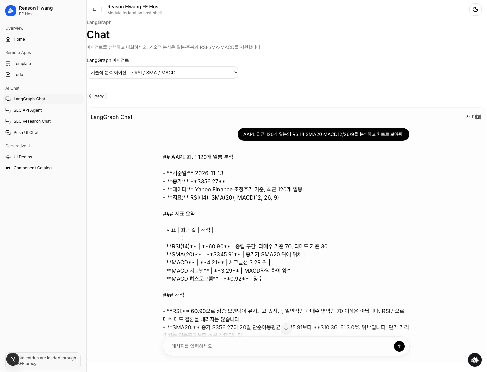
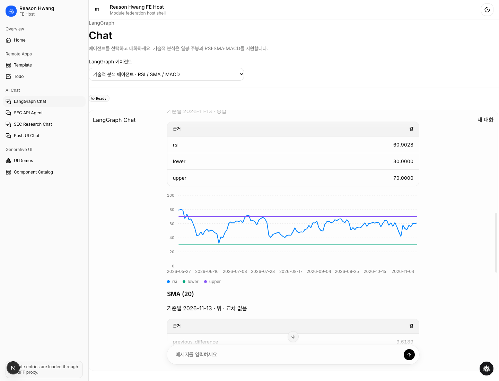
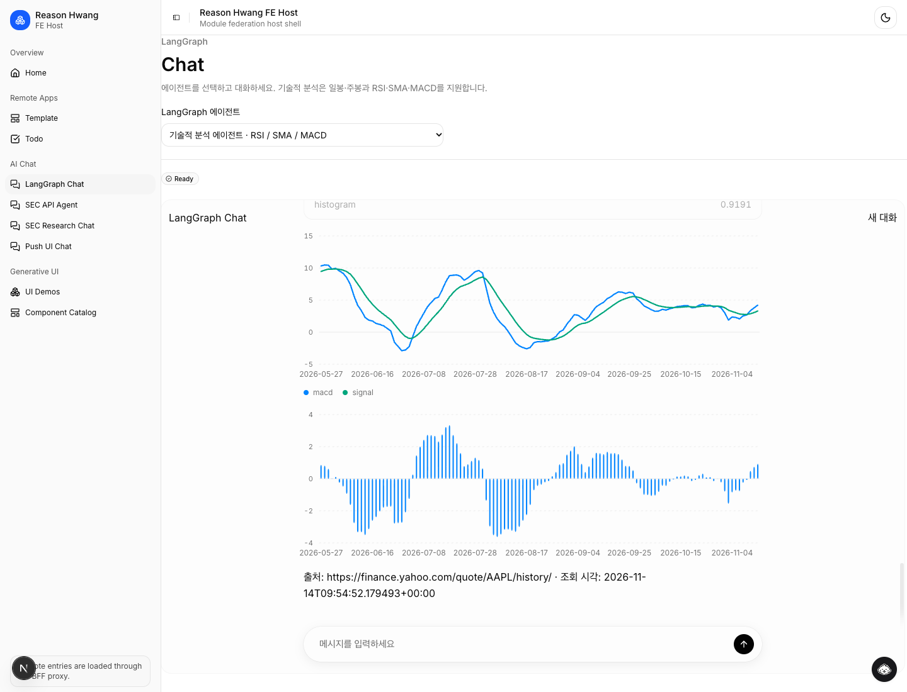

### AAPL 주봉·지표 기간 변경

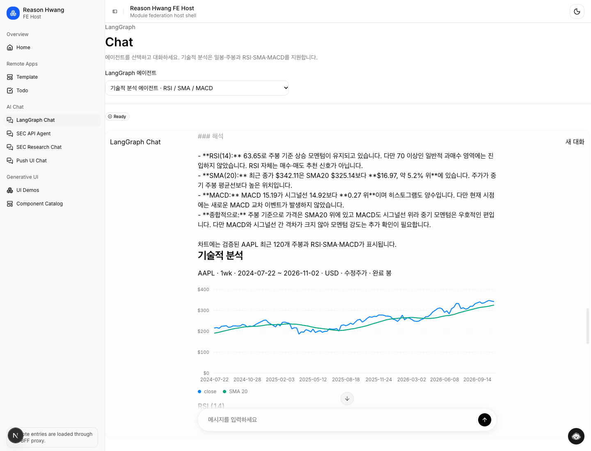
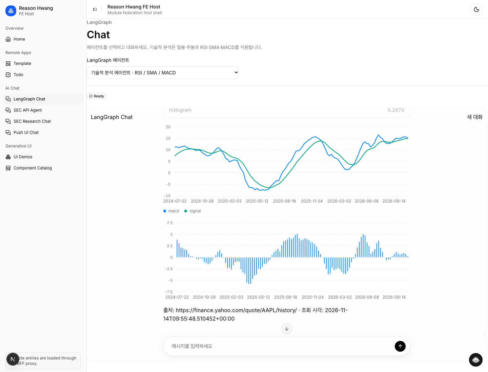
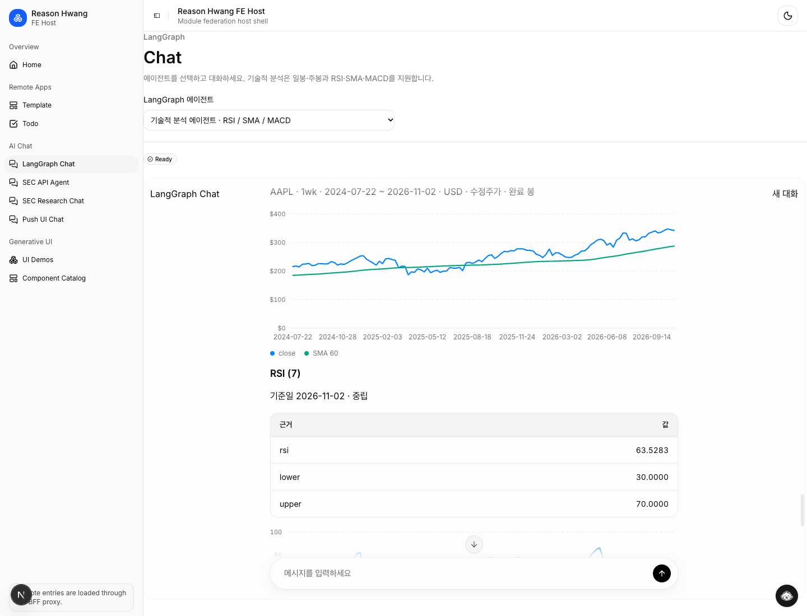

### 삼성전자: 가격·MACD 교차

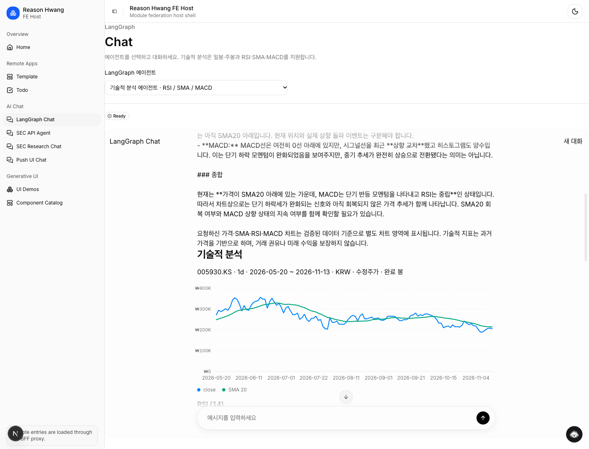
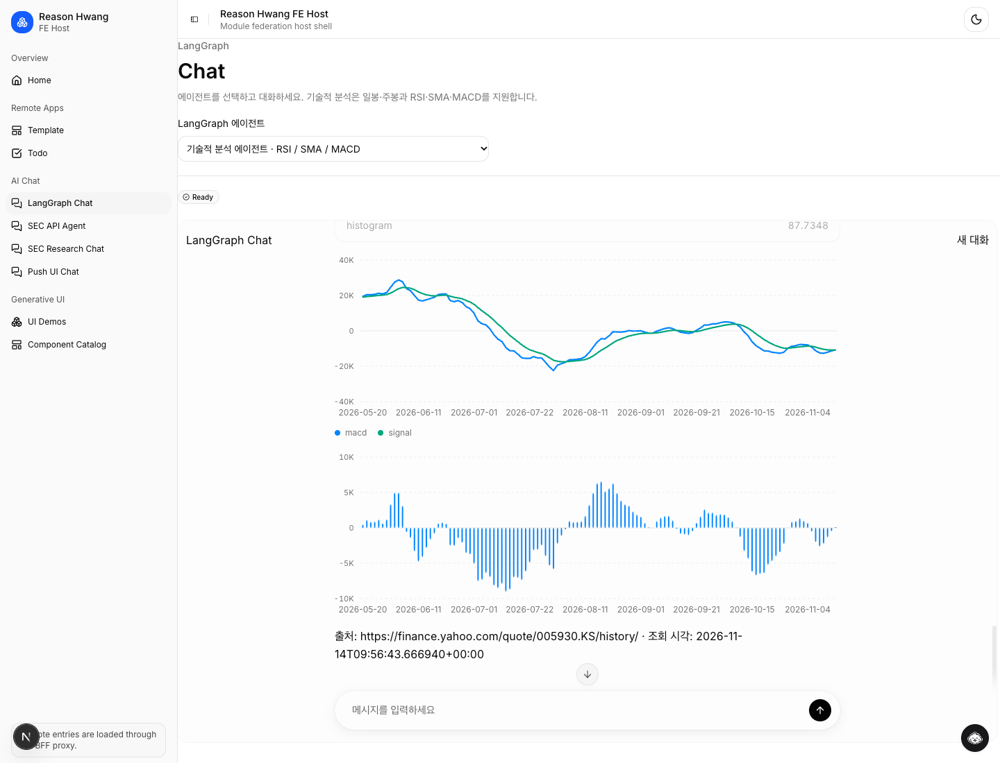

### 경계 입력·오류·격리

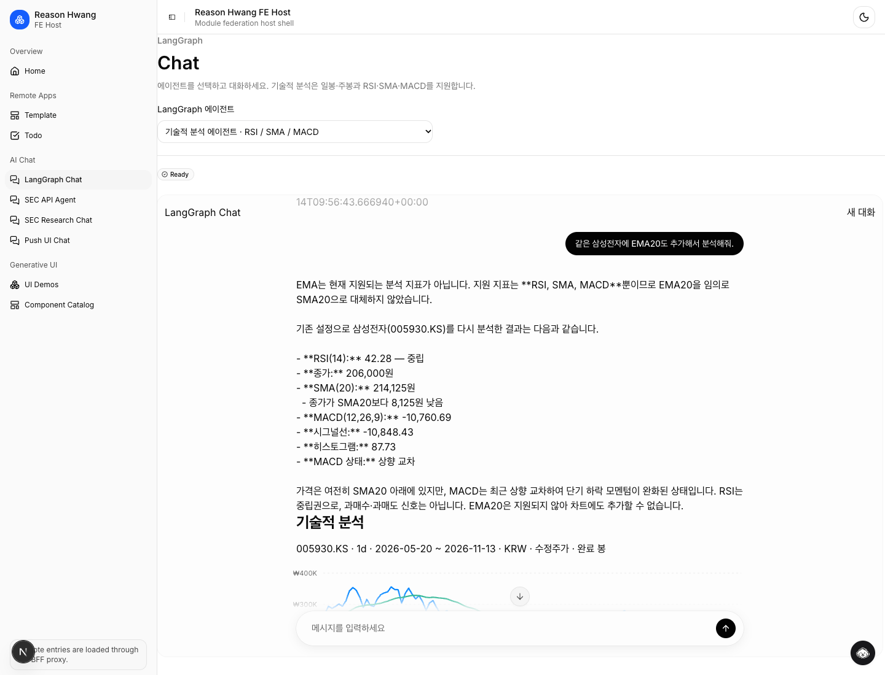
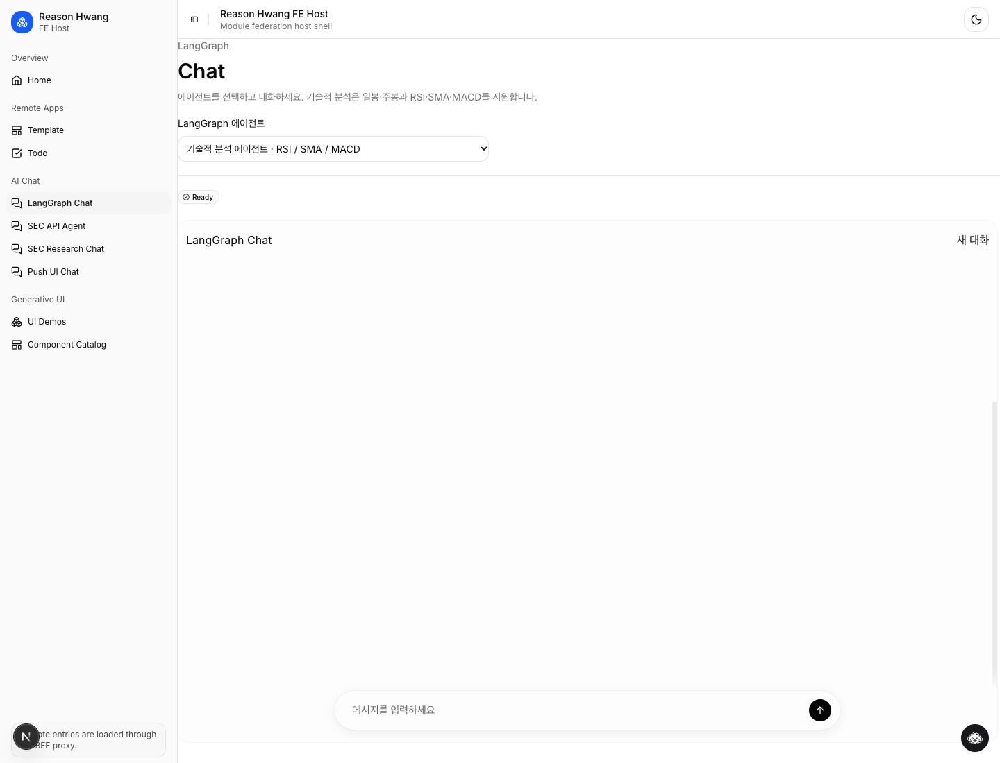
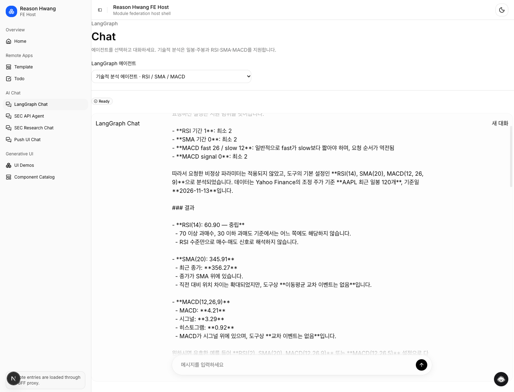
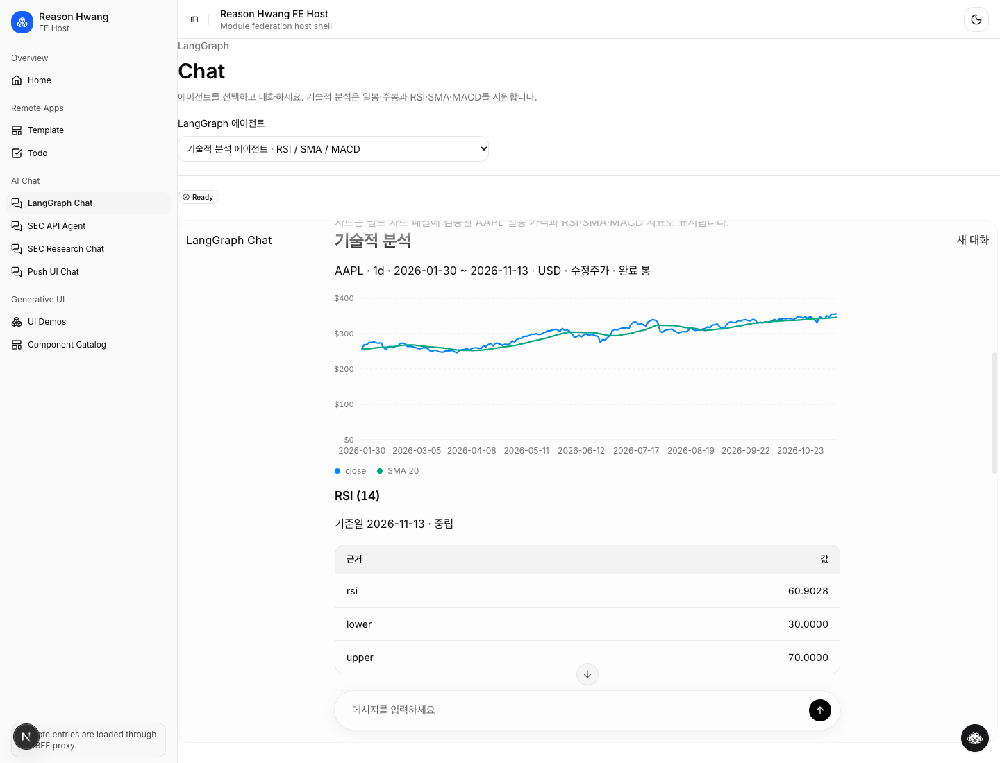
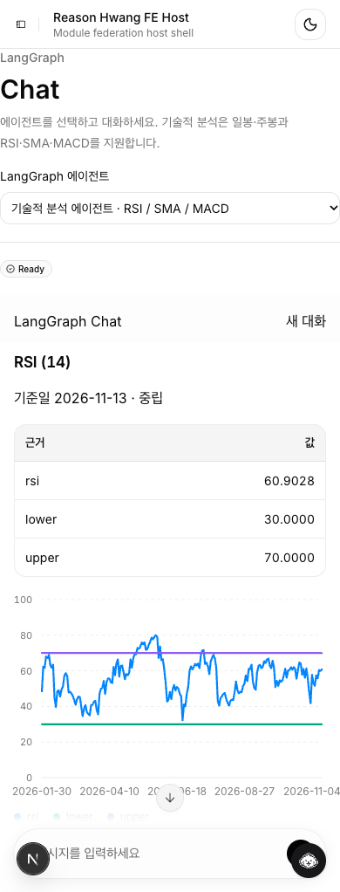
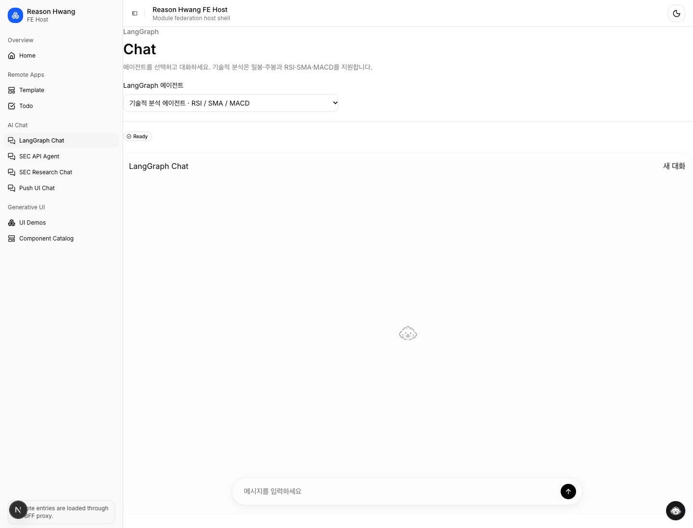


## 실행 환경과 재현

시작가이드.md를 읽고 필요한 서비스만 실행했다. 기존 SSH OAuth proxy 2890은 사용 후 그대로 유지했다. BFF·Remote·FastAPI·DB 서비스는 이번 그래프 경로 검증에 새로 시작하지 않았다.

```sh
pnpm -C 3-langgraph-fast dev:langgraph
LANGGRAPH_INTERNAL_API_URL=http://127.0.0.1:2982 pnpm -C 1-fe-host dev
# http://127.0.0.1:2983/chat
```

AAPL 기본 질문 → 같은 종목 주봉 → RSI7/SMA60 순으로 후속 대화를 실행했다. 새 대화에서 삼성전자 → EMA 요청을 실행했다. 잘못된 티커, 잘못된 기간, 200봉은 새 대화로 구분했다. 마지막에 그래프 전환 후 종목 미지정 질문과 5분봉 요청을 실행했다.

검증의 범위 밖: 장중 실시간 데이터, 모든 시장·종목, 매수/매도 수익성, Firefox/Safari, 장시간 부하, 가격 공급자와 독립된 별도 원천의 수치 대조. Chrome 이외의 브라우저 통과를 의미하지 않는다.

## 자원 정리

- `browser_close`로 작업용 Chrome 종료. PID 36305 잔존 없음 확인.
- 작업 소유 LangGraph 2982(PID 36255/36266), Host 2983(PID 36790)은 실행 세션에 종료 신호를 보내 정상 종료했다.
- `ps`에서 위 PID가 없고, `lsof`에서 2982·2983 리스닝 포트가 없음을 확인했다.
- 기존 SSH OAuth proxy 2890 및 공유 MCP 서버는 유지했다. 환경파일·애플리케이션 코드는 변경하지 않았다.
