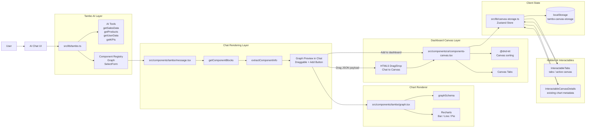
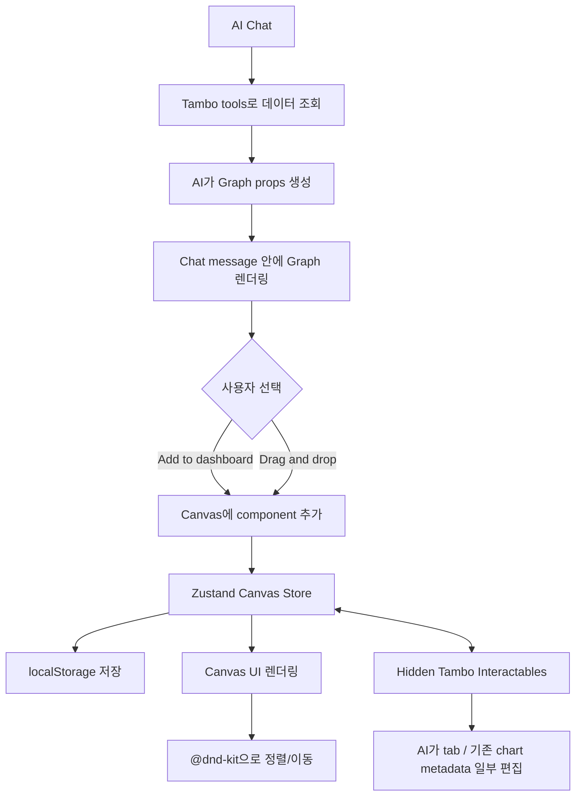

# Analytics Template Architecture

이 문서는 AI chat에서 생성된 차트가 chat preview를 거쳐 canvas/dashboard에 저장되는 전체 흐름을 설명합니다.

## High-Level Architecture



## Core Flow



핵심 정책은 다음과 같습니다.

> AI는 차트를 직접 dashboard/canvas에 추가하지 않습니다. 먼저 chat 안에 `Graph` preview로 생성하고, 사용자가 버튼 또는 drag/drop으로 canvas에 추가해야 dashboard 상태로 저장됩니다.

전체 흐름은 다음 순서로 이해할 수 있습니다.

```text
AI tool call
  -> Graph props 생성
  -> Chat message 안 Graph 렌더링
  -> 사용자 승인 또는 drag/drop
  -> Canvas store 추가
  -> localStorage 저장
  -> Canvas UI에서 정렬/편집
```

## Main Responsibilities

| Area | File | Responsibility |
| --- | --- | --- |
| AI registration | `src/lib/tambo.ts` | Tambo tools/components 등록, AI 사용 정책 설명 |
| Chat rendering | `src/components/tambo/message.tsx` | Tambo component block 추출, `Graph` preview 표시, add/drag 처리 |
| Chart renderer | `src/components/tambo/graph.tsx` | `graphSchema` 검증, Recharts 기반 bar/line/pie 렌더링 |
| Canvas UI | `src/components/ui/components-canvas.tsx` | canvas tab, drop, 정렬, 이동, 삭제 처리 |
| Canvas store | `src/lib/canvas-storage.ts` | Zustand + persist로 localStorage 저장 |
| AI edit surface | `interactable-tabs.tsx`, `interactable-canvas-details.tsx` | AI가 기존 canvas 상태 일부를 읽고 편집 |

## 1. Tambo Registration

`src/lib/tambo.ts`에서 Tambo에 AI가 사용할 수 있는 tools와 components를 등록합니다.

Tools:

- `getSalesData`
- `getProducts`
- `getUserData`
- `getKPIs`

Components:

- `Graph`
- `SelectForm`

`Graph` component description에는 중요한 정책이 들어 있습니다. 차트는 먼저 chat 안에 생성하고, canvas/dashboard에 바로 넣지 않아야 합니다. 사용자가 추가 여부를 결정해야 합니다.

## 2. Chat Message Rendering

`src/components/tambo/message.tsx`의 `MessageRenderedComponentArea`가 assistant message 안의 Tambo component block을 읽습니다.

주요 처리 흐름:

- `getComponentBlocks(message)`로 AI가 생성한 component block 추출
- `extractComponentInfo()`로 component 이름과 props 추출
- `Graph`일 경우 `data`, `title`, `showLegend`, `variant`, `size`, `className`만 정규화
- `isDraggableComponent()`는 현재 `Graph`만 draggable로 허용

즉 AI가 만든 차트는 Tambo message content 안의 `Graph` component block으로 들어오고, UI에서는 이를 drag 가능한 chart 또는 `Add to dashboard` 버튼으로 노출합니다.

## 3. Graph Rendering

`src/components/tambo/graph.tsx`가 실제 chart renderer입니다.

주요 특징:

- `graphSchema`로 AI가 넘길 수 있는 props 구조 제한
- 지원 chart type은 `bar`, `line`, `pie`
- 내부 rendering은 Recharts 사용
- 데이터가 없거나 불완전하면 fallback UI 표시

대표 데이터 구조:

```ts
{
  title: string;
  data: {
    type: "bar" | "line" | "pie";
    labels: string[];
    datasets: [
      {
        label: string;
        data: number[];
        color?: string;
      }
    ];
  };
}
```

데이터가 준비되지 않은 경우 다음과 같은 상태 UI가 표시될 수 있습니다.

- `Awaiting data...`
- `Building chart...`
- `Preparing datasets...`

## 4. Saving From Chat To Canvas

chat에서 canvas로 저장하는 경로는 두 가지입니다.

### Add Button

`message.tsx`의 `addToDashboard()`가 현재 active canvas를 찾습니다. active canvas가 없으면 새 canvas를 만든 뒤 `useCanvasStore.addComponent()`를 호출합니다.

### Drag And Drop

chat 안의 `Graph` wrapper에는 `draggable={true}`가 붙습니다. `onDragStart`에서 `dataTransfer`에 JSON payload를 심습니다.

```ts
{
  component: "Graph",
  props: {
    ...componentProps,
    componentId,
    _inCanvas: false,
    _componentType: "Graph"
  }
}
```

Canvas 쪽에서는 `src/components/ui/components-canvas.tsx`의 `handleDrop()`이 이 JSON을 읽어서 active canvas에 추가합니다.

## 5. Canvas Store

`src/lib/canvas-storage.ts`는 Zustand store입니다. `persist` middleware를 사용해 browser `localStorage`에 저장합니다.

저장 key:

```text
tambo-canvas-storage
```

상태 구조는 대략 다음과 같습니다.

```ts
{
  canvases: [
    {
      id,
      name,
      components: [
        {
          componentId,
          _componentType: "Graph",
          _inCanvas: true,
          canvasId,
          ...graphProps
        }
      ]
    }
  ],
  activeCanvasId
}
```

주요 actions:

- `createCanvas`
- `updateCanvas`
- `removeCanvas`
- `setActiveCanvas`
- `clearCanvas`
- `addComponent`
- `updateComponent`
- `removeComponent`
- `moveComponent`
- `reorderComponent`
- `reorderCanvas`

현재 canvas 상태는 서버가 아니라 browser `localStorage` 기반입니다.

## 6. Canvas UI And Sorting

`src/components/ui/components-canvas.tsx`가 실제 canvas 화면을 담당합니다.

주요 기능:

- 첫 진입 시 기본 canvas 생성
- canvas tab 생성, 이름 변경, 삭제
- active canvas 전환
- canvas 비우기
- 외부 chat chart drop을 받아 `addComponent`
- canvas 간 component 이동
- canvas 내부 component 순서 변경

내부 정렬은 `@dnd-kit`을 사용합니다.

- `DndContext`
- `SortableContext`
- `useSortable`
- `verticalListSortingStrategy`

같은 canvas 안에서 순서를 바꾸면 `reorderComponent()`가 호출됩니다. 다른 canvas로 옮기는 경우 HTML5 `dataTransfer` 기반 drop에서 `moveComponent()`를 호출합니다.

## 7. AI Interactables

`src/components/ui/interactable-tabs.tsx`와 `src/components/ui/interactable-canvas-details.tsx`는 숨겨진 Tambo interactable입니다.

### InteractableTabs

AI 쪽에 canvas tab 목록, 이름, `activeCanvasId`를 노출합니다. AI가 tab 이름, 순서, active canvas를 조정할 수 있습니다.

### InteractableCanvasDetails

active canvas 안의 `Graph` 목록만 노출합니다. AI는 기존 chart의 `title`, `type`만 수정할 수 있습니다.

이 interactable은 새 chart 생성용이 아닙니다. 새 chart는 먼저 chat에 `Graph`로 생성된 뒤 사용자가 canvas에 추가해야 합니다.

## Summary

이 라이브러리의 핵심 구조는 다음과 같습니다.

1. Tambo가 AI tools와 `Graph` component를 알고 있습니다.
2. AI가 필요하면 데이터 tool을 호출하고 `Graph` props를 생성합니다.
3. `Graph`는 chat message 안에 먼저 렌더링됩니다.
4. 사용자가 버튼 또는 drag/drop으로 canvas에 저장합니다.
5. canvas 상태는 Zustand + localStorage에 저장됩니다.
6. canvas 내부 정렬/이동은 `@dnd-kit`과 HTML5 drag/drop을 함께 사용합니다.
7. 숨겨진 interactable을 통해 AI가 canvas tab과 기존 chart metadata를 일부 편집할 수 있습니다.

한 문장으로 정리하면, Tambo는 AI가 데이터와 `Graph` component를 만들 수 있게 해주고, Chat은 이를 preview로 보여주며, Canvas는 사용자가 승인한 `Graph`만 Zustand/localStorage에 저장해서 dashboard로 관리하는 구조입니다.
