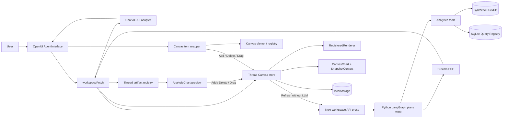

# Chat + Canvas Architecture

현재 프로젝트의 Python LangGraph + OpenUI 구성과 Chat에서 Canvas로 분석 차트와 등록된 OpenUI 콘텐츠를 추가하는 흐름을 설명한다. 2026-10-18 코드 대조 기준이다. 통합 계약은 [제품 설계](../business.md)와 [시스템 설계](../system.md), 상태·배치는 [Canvas 상세 설계](canvas-system.md), 스트리밍·도구는 [UI 생성 시스템](ui-generative-system.md)을 따른다. 이 문서들은 통합 stock의 상세 설명이며 별도 제품 계약을 만들지 않는다.

## High-Level Architecture

Python의 스트림은 자체 SSE다. Chat 텍스트만 브라우저에서 AG-UI 이벤트로 변환한다. 전체 backend가 AG-UI를 직접 구현하거나 frontend tool의 결과를 기다렸다가 재개하는 구조는 아직 아니다.

## Core Flow

### 일반 Chat과 분석 차트

1. `AgentInterface`의 요청을 `workspaceFetch`가 현재 thread의 Canvas/Chat artifact 문맥과 함께 보낸다.
2. planner가 일반 Chat, 분석 차트 생성, Canvas 작업, 설명 또는 확인 요청을 구분한다.
3. 일반 UI/표 요청은 기존 DeepAgents + OpenUI 생성 경로를 사용한다.
4. Chat 분석 차트 요청은 `publish_analysis_chart`로 SQL 검증·실행·등록 후 실제 artifact ID를 발급한다.
5. 서버가 발급된 ID로 `root = Col([AnalysisChart("artifact-id")])`를 구성한다. 여러 차트는 준비되는 순서대로 전달한다.
6. 브라우저가 artifact를 thread별 registry에 저장하고 Chat 컴포넌트가 snapshot을 표시한다.
7. 사용자가 Add to Canvas를 누르면 활성 탭에 독립 패널을 추가한다.

임의 Chat Root/AST에서 차트를 추출하지 않는다. 등록된 분석 artifact를 참조하는 `AnalysisChart`가 추가 가능한 경계다.

### 명시적인 Canvas 요청

“매출과 광고비 Canvas” 같은 요청은 Canvas 생성 경로로 간다. Chat에는 진행 설명을 보내고 Canvas에는 위젯별 생성·commit 이벤트를 보낸다. 설명이 비면 기본 안내를 채운다. 따라서 모든 차트가 사용자 Add 버튼을 거쳐야 하는 정책은 아니다. 일반 Chat 분석 차트의 추가는 사용자 버튼으로, 명시적인 Canvas 생성은 backend 계획으로 처리한다.

### 데이터 갱신

Canvas 필터/수동 새로고침/polling → queryId 조회 API → 기존 SQL 재실행 → 해당 패널 snapshot 교체 순서다. 이 경로는 LLM이나 OpenUI 프로그램 재생성을 요구하지 않는다. Chat 당시 snapshot은 유지한다.

## Main Responsibilities

아래 경로는 프로젝트 루트 기준이다.

| 영역 | 파일 | 책임 |
|---|---|---|
| 화면 구성 | `frontend/src/pages/chat/ui/chat-page.tsx` | AgentInterface, AnalysisHost, CanvasPanel 결합 |
| 스트림 분배 | `frontend/src/features/manage-canvas/api/transport.ts` | 요청 문맥, Chat AG-UI 변환, artifact/Canvas 분배 |
| thread 연결 | `frontend/src/features/manage-canvas/model/chat-storage.tsx` | 채팅 저장과 Canvas 수명주기 연결 |
| Canvas 상태 | `frontend/src/features/manage-canvas/model/store.ts` | thread별 조작·저장·조회·이벤트 적용 |
| 데이터 계약 | `frontend/src/entities/analysis/model/model.ts` | Zod 문서/위젯/조회/artifact 스키마 |
| Chat artifact | `frontend/src/entities/analysis/model/artifacts.ts` | thread별 registry와 host context |
| Chat 차트 | `frontend/src/entities/analysis/ui/analysis-chart.tsx` | snapshot, 조회 정의, 추가 버튼 |
| OpenUI 등록 | `frontend/src/entities/analysis/ui/library.tsx` | chatLibrary, canvasLibrary, 프로그램 검증 |
| Canvas UI | `frontend/src/pages/chat/ui/panel.tsx` | 탭, 패널, resize, polling |
| Python API | `backend-langgraph/agent/app.py` | run SSE, query 정의/실행, health |
| 생성 workflow | `backend-langgraph/agent/canvas_graph.py` | planner와 work, 분석 artifact 발급 |
| 데이터 서비스 | `backend-langgraph/agent/analytics.py` | DuckDB 분석과 SQLite query registry |

## 1. OpenUI Registration

기존 범용 UI는 `frontend/src/shared/ui/openui`에 유지한다. `chatLibrary`는 기본 라이브러리에 `AnalysisChart`와 `CanvasItem`을 추가하고, `canvasLibrary`는 `CanvasChart`를 추가한다. 두 라이브러리의 root 컴포넌트는 `Col`이다.

`frontend/src/app/config/library.ts`에서 Chat 카탈로그를 생성한다. 변경 후 `npm run generate`로 `frontend/generated/`를 갱신하고 system prompt를 Python의 `agent/system-prompt.txt`로 명시적으로 동기화해야 한다. backend가 frontend 파일을 런타임에 읽지는 않는다.

## 2. Chat Message Rendering

`workspaceFetch`는 Chat delta를 AG-UI 텍스트 메시지 이벤트로 변환하고 `agUIAdapter`를 통해 OpenUI에 연결한다. `AnalysisChart(artifactId)`는 AnalysisHost의 threadId로 registry를 조회한다. 컴포넌트 렌더링 자체가 데이터를 다시 fetch하지 않는다.

도구 결과와 UI의 연결 키는 실제 서버 발급 artifactId다. 모델이 임의 ID를 만들거나 전체 SQL 결과를 Root에 반복 삽입할 필요가 없다.

## 3. Chart Rendering

Canvas 패널마다 OpenUI Renderer와 SnapshotContext를 둔다. `CanvasChart(title, chartType)`는 context의 `period/value` 행을 기본 `Chart` 컴포넌트에 전달한다. 지원 타입은 bar, line, area, pie, donut, scatter다. 데이터가 없으면 빈 결과 안내를 표시한다.

프로그램 문자열은 `validProgram`으로 파싱·완결성·미해결 참조를 검사한다. 표현 변경은 해당 위젯 program 교체, 데이터 변경은 해당 snapshot 교체로 구분한다.

## 4. Saving From Chat To Canvas

`addArtifact`는 artifact 검증 → 깊은 복사 → 새 widgetId 발급 → sourceArtifactId 연결 → 활성 탭 저장을 수행한다. 독립 parameters/snapshot과 기본 레이아웃, manual 갱신 정책을 만든다. 같은 artifact 재추가는 기존 패널 선택으로 처리하며 패널 삭제 후 재추가는 가능하다.

추가 동작은 LLM/SQL을 실행하지 않는다. 실행 중이거나 thread가 없거나 저장 호환성이 차단된 상태에서는 추가하지 않는다. Chat → Canvas drag/drop도 같은 추가 액션을 호출한다.

## 5. Canvas Store

Chat thread 하나에 Canvas 작업공간 하나가 연결되고 작업공간 안에 여러 탭을 둔다. 새 채팅 draft는 메모리에 존재하다 thread 생성 시 이전된다. 선택·reload·삭제는 연결된 Canvas와 artifact에 함께 반영된다. 완료 문서는 localStorage에 저장한다. 계정별 서버 저장이나 공유는 없다.

## 6. Canvas UI And Sorting

탭 생성/선택/이름 변경/삭제, 패널 크기 조절, 다른 탭으로 이동, 맨 위로 이동, 삭제를 지원한다. HTML5 DnD로 패널 앞/빈 영역 끝에 재정렬하고 탭 버튼에 놓아 이동한다. dnd-kit과 자유 x/y 좌표 배치는 사용하지 않는다. resize 손잡이는 pointer 시작·종료 좌표로 너비 열 수와 높이 px를 계산한다.

## 7. AI Context And Edit Surface

요청마다 전체 탭, 활성 탭, 위젯 정의·snapshot·배치, 선택 위젯, 진행·갱신 실패 상태와 최근 Chat artifact를 Python에 전달한다. 상태 설명은 읽기 전용 계획으로 처리한다. 현재 상태 전달은 요청 시점 snapshot이며 실시간 양방향 동기화가 아니다.

자연어 차트 생성/변경/삭제와 갱신 정책 변경은 backend Canvas 이벤트 경로로 처리한다. 탭·크기·탭 간 이동의 자연어 조작과 AG-UI frontend tooling은 미구현이다. 후속 구조는 [공통 명령과 frontend tool](canvas-system.md#후속-설계-공통-명령과-frontend-tool)을 참고한다.

## REG-01 / DND-01 확장 경계

`registration.tsx`의 registerCanvasElement는 ID·version·library를 등록한다. 기본 openui 등록은 기존 전체 기본 카탈로그를 사용한다. CanvasItem의 완성된 독립 program과 uiState를 RegisteredWidget으로 복사한다. registry wrapper가 Chat 추가/삭제/drag affordance를 제공하고 Canvas 호스트는 종류와 무관하게 배치·선택·저장한다.

Python Operation.kind는 analysis/registered다. registered Chat 계획은 program을 생성하고 CanvasItem 문자열로 감싸며, Canvas 계획은 쿼리 없는 registered widget commit을 반환한다. 기존 분석 도구와 SQL 경로는 유지한다. 일반 위젯 수정은 프로그램을 교체하고 uiState를 초기화하며 다른 위젯은 보존한다.

문서 v3는 분석/등록 위젯 union을 저장하며 v2 분석 문서를 읽는다. 추가·삭제·DnD·resize는 모델이나 SQL을 호출하지 않는다. 상세 등록 예제와 지원 경계는 [Canvas registry 계약](canvas-system.md#reg-01-canvas-registry와-wrapper)을 따른다.
