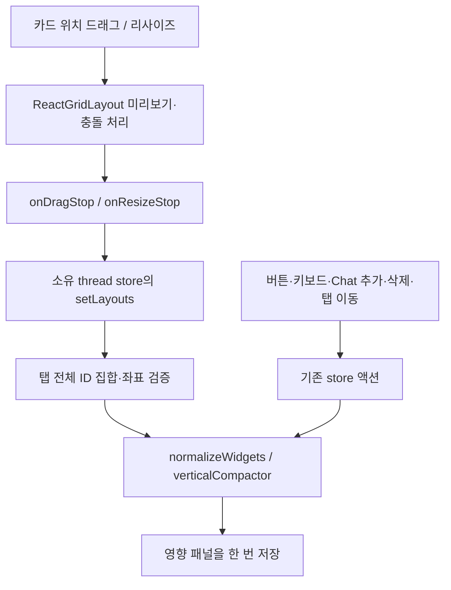

# Dynamic Canvas System

현재 구현의 상태·등록·조작·렌더링 계약이다. [통합 시스템](../system.md), [Architecture](architecture.md), [UI 생성](ui-generative-system.md)을 함께 읽는다.

## REG-01: Canvas registry와 wrapper

OpenUI library는 컴포넌트·함수·액션의 표현 계약이다. Canvas registry는 그 library로 작성한 독립 프로그램을 저장 가능한 콘텐츠로 등록하는 계약이다. 모든 기본 OpenUI 요소 및 조합을 표현할 수 있는 `openui` 등록을 기본 제공한다. 특정 요소만 쓰도록 제한한 library나 새 컴포넌트를 포함한 library도 개발자가 등록할 수 있다.

등록 코드는 `frontend/src/entities/analysis/ui/registration.tsx`에 있다. 외부에서는 `@/entities/analysis` public API를 사용한다.

```ts
registerCanvasElement({
  id: "my-library",
  version: 1,
  library: myOpenUILibrary,
});
```

등록은 앱 초기화 시 Chat/Canvas가 렌더링되기 전에 수행한다. ID 중복은 오류다. custom library를 모델이 생성하게 하려면 해당 컴포넌트 명세를 프롬프트에도 내보내야 한다. 기본 Python 생성 경로는 `openui`를 사용하며 임의의 registry ID를 자동 발견하지 않는다.

Chat OpenUI에서 사용하는 wrapper:

```text
root = Col([
  CanvasItem("openui", "메모", "root = Col([Text(\"오늘의 인사이트\")])"),
  CanvasItem("openui", "비교표", "root = Col([Table([\"항목\", \"값\"], [[\"A\", 10]])])")
])
```

`CanvasItem(registrationId, title, program)`의 program은 JSON 이스케이프한 문자열이다. wrapper 바깥 변수에 의존하지 않는 완성된 독립 root를 전달한다. 임의 Chat Root에서 subtree를 자동 추출하지 않는다. wrapper를 다시 wrapper 내부에 넣지 않는다. 분석 전용 AnalysisChart/CanvasChart는 기본 registry library에 없으며 기존 분석 어댑터를 사용한다.

`CanvasRegistrationWrapper`는 React 콘텐츠에도 동일한 affordance를 제공한다. 전달하는 `RegisteredContent`는 화면과 같은 독립 프로그램·입력 상태를 담아야 한다. 임의 JSX, 함수 또는 React element 자체를 localStorage에 직렬화하지 않는다.

자동 제공되는 기능:

- Chat: Add to Canvas, 추가된 패널로 이동, Delete from Canvas, Canvas로 drag copy.
- Canvas: 선택, 삭제, drag reorder, 탭 이동, 너비·높이 조절, 저장·복원.
- 중복 방지: 같은 thread 안에서 sourceId가 같으면 기존 패널을 선택한다. 삭제 후 재추가는 새 widgetId를 만든다.
- 기본 CanvasItem의 sourceId는 registrationId/title/program 조합이다. 동일 제목·프로그램의 재출력은 같은 원본으로 취급한다. React wrapper 사용자는 안정적인 별도 sourceId를 제공할 수 있다.

## REG-02: Canvas State

```ts
type CanvasDocument = {
  schemaVersion: 5;
  threadId: string;
  tabs: { id: string; title: string }[];
  activeTabId: string;
  selectedWidgetId: string | null;
  widgets: CanvasWidget[];
};
type CanvasWidget = AnalysisWidget | RegisteredWidget;
// RegisteredWidget
// kind: "registered", registrationId, registrationVersion: 1,
// sourceId, title, program, uiState, widgetId,
// schemaVersion: 1, catalogVersion: 1, definitionRevision, tabId, layout
```

분석 위젯은 기존 queryId/queryVersion, parameters, snapshot, chartType, refreshPolicy/intervalSeconds와 program을 유지한다. 일반 등록 위젯에는 이 필드를 강제하지 않는다. 등록 위젯에 refresh를 요청해도 쿼리를 실행하지 않는다.

분석 데이터 계약:

| 모델 | 책임 |
|---|---|
| QueryDefinition | Python SQLite의 SQL hash 기반 ID·버전·SQL·제목/설명·파라미터/결과 스키마 |
| ChartArtifact | Chat 시점의 서버 발급 artifactId와 조회 정의·snapshot |
| AnalysisWidget | 새 widgetId/sourceArtifactId와 독립 조건·snapshot·갱신 정책 |
| RegisteredWidget | registry의 library로 렌더링하는 독립 프로그램과 입력 상태 |

분석 parameters는 months 1~24, region ALL/KR/US, 선택적 start_date/end_date 쌍이다. snapshot은 period/value 행과 dataVersion, fetchedAt, sourceWatermark를 갖는다. 실제 업무 데이터가 아닌 합성 데이터다.

## SAVE-REG: Thread와 저장

`canvas-ux:thread-canvas:${encodeURIComponent(threadId)}`에 v5 문서를 저장한다. 기존 v2/v3/v4 문서를 읽고 다음 저장 시 v5로 기록한다. legacy 공용 v0/v1은 기존 명시적 가져오기를 유지한다. 미지원 버전·등록 ID·불완전 프로그램은 저장본 전체를 차단하고 원본을 덮어쓰지 않는다. 복구 가능한 분석 snapshot은 읽기 전용 표로 표시한다.

thread별 store와 진행 실행은 격리된다. New chat은 빈 draft, 첫 메시지에서 thread에 연결한다. 삭제된 thread의 늦은 이벤트는 무시한다. 탭 최대 20개, 패널 최대 50개이며 일반 위젯과 분석 위젯을 합산한다.

Chat 추가는 프로그램과 uiState 또는 분석 snapshot을 깊게 복사한다. Canvas 입력 변경은 Chat 입력에 전파하지 않는다. Canvas uiState는 reload 후 복원한다. 등록 wrapper 내부 Chat 입력의 reload 복원은 별도 메시지 상태 통합 범위이며, 현재 추가 시점의 입력은 Canvas에 보존된다.

## Canvas Command

현재 Zustand 액션이 버튼과 DnD의 공통 변경 경로다. 별도 AG-UI frontend tool executor는 없다.

| 액션 | 동작 |
|---|---|
| addRegistered | registry/프로그램 검증, 중복 검사, 독립 패널 추가 |
| addArtifact | 서버 발급 분석 artifact 검증, 독립 차트 추가 |
| removeSource | Chat 원본 sourceId/artifactId에 연결된 패널 삭제 |
| reorder | beforeId 앞 또는 끝에 삽입, 지정 탭으로 이동 |
| edit / transfer / move / remove | 입력·배치 변경, 탭 이동, 맨 위로, 삭제 |
| setLayouts | 현재 탭의 전체 좌표 집합을 검증하고 영향 패널을 함께 저장 |
| event | 실행 순서·baseRevision·스키마 검사 후 commit |

배치 변경과 uiState 변경은 content definitionRevision을 증가시키지 않는다. 표현·조회 정의 변경은 revision을 증가시킨다. 중복 sequence·종료된 run·충돌하는 baseRevision은 적용하지 않는다. 일반 위젯 프로그램 재생성은 입력 상태를 초기화한다. 데이터 조회 응답은 분석 위젯의 요청 당시 revision이 유효해야 반영한다.

## Canvas Renderer와 액션

```text
AnalysisWidget → canvasLibrary Renderer + SnapshotContext → CanvasChart
RegisteredWidget → registry lookup → RegisteredRenderer(entry.library)
공통 호스트 → 선택 / 배치 / 저장 / 삭제 / DnD
```

일반 위젯은 등록된 library의 parser로 root, incomplete, unresolved, error를 검증한다. 등록 자체가 모든 사용자 생성 프로그램의 정상 동작을 보장하지는 않는다. 각 컴포넌트의 데이터·환경 계약은 여전히 필요하다.

OpenUI 내부 상태 액션은 해당 Renderer가 처리한다. CopyToClipboard는 기존 액션 handler에 연결한다. 별도 호스트가 필요한 액션은 안내를 표시한다. 서버 쓰기·결제·tool continuation을 등록만으로 부여하지 않는다. Python/provider 실행은 사용자 자연어 요청 경로이며 DnD/추가에는 필요 없다.

## DND-01: Drag Drop Layer

좌표 이동·리사이즈는 ReactGridLayout이 처리하고, Chat 추가·탭 이동·순서 재정렬은 HTML5 DnD를 사용한다. `application/x-openui-canvas` MIME의 payload:

```ts
type CanvasDrag =
  | { version: 1; threadId: string; type: "registered"; content: RegisteredContent }
  | { version: 1; threadId: string; type: "analysis"; artifactId: string }
  | { version: 1; threadId: string; type: "widget"; widgetId: string };
```

- Chat 핸들 → Canvas: 활성 탭에 추가하고, grid 안의 드롭 위치는 시작 좌표로 적용한 뒤 충돌을 정리한다.
- Chat 핸들 → 패널: 배열 삽입 후 드롭 좌표를 적용한다. 최종 화면 위치는 충돌 정리에 따라 달라진다.
- Canvas ↗ 핸들 → 패널: 그 패널 앞에 재정렬.
- Canvas ↗ 핸들 → 빈 영역: 활성 탭 끝으로 이동.
- Chat/Canvas 핸들 → 탭 버튼: 해당 탭에 추가/이동.
- 다른 thread, 잘못된 JSON/버전, 미등록 요소, 존재하지 않는 artifact/패널은 반영하지 않는다.
- 실행 중·호환성 차단 상태에서는 드래그 변경을 하지 않는다.

native DnD는 desktop 기준으로 검증했다. ↗ 핸들에서 Alt+위/아래로 순서를 바꾸고, ⠿ 핸들에서 방향키로 좌표를 이동한다. 터치 환경에서는 Add/삭제/탭 이동 컨트롤을 사용할 수 있으며 터치 상호작용은 별도 검증 범위다.

## Canvas Item Grid System / Resize

### 좌표와 실제 화면 크기

Grafana의 수동 배치 그리드와 같은 `react-grid-layout` 엔진을 사용한다. OpenUI는 카드 내부 콘텐츠를 렌더링하고, 그리드 엔진은 카드 바깥 위치·크기·충돌을 관리한다.

| 항목 | 현재 값 |
|---|---|
| 열 수 | 24 |
| 행 높이 / 카드 간격 | 30px / 8px |
| 기본 크기 | 12열 × 14행 |
| 허용 크기 | 너비 1~24열, 높이 4~40행 |
| 위치 | 정수 x/y, x ≥ 0, y ≥ 0, x+w ≤ 24 |
| 좁은 화면 기준 | Canvas 컨테이너 폭 600px 미만 |

```ts
// 정규화·저장 후 패널 예시: 같은 행의 오른쪽 절반
layout: { x: 12, y: 0, w: 12, h: 14 }
```

컨테이너 폭을 W라고 하면 가로 한 칸의 이동 간격은 `(W + 8) / 24`, 세로는 `30 + 8 = 38px`다. 카드의 실제 너비는 `w * (W + 8) / 24 - 8`, 높이는 `h * 38 - 8`이다. 따라서 기본 14행 카드 높이는 524px이다. 좌표 없는 새 패널은 임시 `{w,h}`를 받아도 되지만 저장 전에 `normalizeWidgets`가 x/y를 부여한다.

### 조작 안내

| 원하는 작업 | 조작 | 결과 |
|---|---|---|
| 같은 탭에서 위치 변경 | 카드 상단 ⠿ 드래그 | 그리드 좌표 이동, 이웃 카드 충돌 처리 |
| 키보드로 위치 변경 | ⠿에 포커스 후 방향키 | 한 칸 이동 후 충돌·위쪽 빈 공간 정리 |
| 크기 변경 | 카드 우하단 핸들 드래그 | 가로·세로 스냅 및 미리보기 |
| 키보드로 크기 변경 | 너비 선택 / 높이 슬라이더 | 같은 배치 정규화 경로 적용 |
| 진행 중 변경 취소 | 드래그·리사이즈 중 Escape | 저장하지 않고 이전 상태로 복원 |
| 다른 탭으로 이동 | ↗를 탭 버튼에 드롭 또는 탭 이동 선택 | 대상 탭에 배치, 입력·콘텐츠 유지 |
| 순서 재배치 | ↗로 카드에 드롭 또는 Alt+위/아래 | 배열 순서를 바꾸고 대상 탭을 다시 배치 |
| 카드 추가 | Chat의 Add to Canvas 또는 드래그 | 독립 패널 생성; grid 안 드롭은 포인터 좌표를 시작점으로 사용 |

우하단 핸들은 hover 없이 표시한다. 입력·버튼 클릭은 위치 드래그를 시작하지 않는다. 높이가 부족한 콘텐츠는 카드 안에서 스크롤한다. 세로 compaction 때문에 아래로 옮겨도 위쪽에 장애물이 없으면 다시 위로 올라갈 수 있다. 빈 공간을 임의로 남기는 자유 배치 모드는 없다.

### 이벤트와 저장 경로



마우스 동작 도중의 엔진 미리보기는 localStorage에 매 프레임 기록하지 않는다. stop에서 현재 탭 전체 좌표를 전달한다. 이동한 카드만 저장하면 밀려난 카드의 위치가 reload 후 돌아오므로 `setLayouts`는 전체 집합을 검증한다. 누락·중복·다른 탭 ID가 있으면 반영하지 않는다. 실행 중·호환성 차단·폐기된 store에서도 배치 commit을 거부한다.

`normalizeWidgets`는 탭별로 분리해 처리한다. 좌표가 없는 패널은 위에서 아래, 왼쪽에서 오른쪽 순서로 빈 자리를 찾는다. 이후 `verticalCompactor`가 겹침과 위쪽 빈 공간을 정리한다. 삭제 시 남은 카드도 정규화한다. 배치 변경은 `program`, `uiState`, 조회 정의·snapshot 및 `definitionRevision`을 변경하지 않으며 LLM/SQL을 호출하지 않는다.

### 저장 버전과 이행

| 저장 형태 | 읽을 때 변환 |
|---|---|
| v2/v3의 `{width,height}` | `w = width * 2`, `h = round((height + 8) / 38)` |
| v4의 12열 `{w,h}` | `w = oldW * 2`, `h = round((oldH * 48 - 16 + 8) / 38)` |
| v5의 `{x,y,w,h}` | 현재 좌표 계약으로 읽고 탭별 충돌 정리 |

변환 결과는 현재 크기 범위로 제한한다. 예를 들어 v4 `{w:6,h:11}`은 `{w:12,h:14}`가 된다. 그 뒤 빈 자리에 x/y를 부여한다. schemaVersion은 다음 저장에서 5로 기록하며 문서를 읽기만 했다는 이유로 원본을 즉시 덮어쓰지 않는다. 미지원 버전·잘못된 문서는 기존 원본 보존 정책을 따른다.

### 반응형 표시와 splitter

`useContainerWidth`가 실제 Canvas 폭을 측정하므로 Chat/Canvas splitter를 움직여도 카드 폭이 다시 계산된다. 컨테이너 폭 600px 미만에서는 렌더링용 layout만 한 열로 투영하고 엔진 drag/resize를 끈다. 이 투영을 저장하지 않으므로 넓은 화면으로 돌아오면 기존 데스크톱 좌표를 사용한다. 키보드·너비/높이 컨트롤은 명시적인 편집 액션이며 단순 화면 투영과 구분된다.

### 코드 지도와 확장 규칙

경로는 프로젝트 루트 기준이다.

| 파일 | 책임 |
|---|---|
| `frontend/src/entities/analysis/model/grid.ts` | 크기·좌표 스키마, clamp, 이전 문서 변환 |
| `frontend/src/features/manage-canvas/model/layout.ts` | 탭별 빈 자리 탐색·충돌·vertical compaction |
| `frontend/src/features/manage-canvas/model/store.ts` | setLayouts 및 저장·thread 수명 관리 |
| `frontend/src/pages/chat/ui/dashboard-grid.tsx` | 엔진 설정·측정·stop 이벤트·Escape·좁은 화면 투영 |
| `frontend/src/pages/chat/ui/grid-item.tsx` | 공통 카드·내부 스크롤·크기 표시 |
| `frontend/src/pages/chat/ui/panel.tsx` | 조작 컨트롤과 native DnD 어댑터 |
| `frontend/src/pages/chat/ui/workspace.css` | 핸들·placeholder·카드 표시 |

새 OpenUI 요소는 registry에 추가한다. 카드 종류마다 배치 로직을 복제하지 않는다. 열 수·행 간격을 바꾸려면 스키마/엔진/드롭 좌표 계산/기본 생성값/저장 이행/테스트를 함께 점검한다. `grid.ts`의 `resizeGrid`는 계산 유틸리티로 남아 있지만 현재 마우스 resize 경로는 ReactGridLayout이 처리한다.

### 검증과 재현

2026-10-19 구현 검증: frontend 356개, Python 관련 29개, 전체 Chrome 21개 통과. 최종 핸들 표시 변경 뒤 Grafana 전용 3개를 재검증했다. 세부 결과와 당시 실패·수정 내역은 [Grafana 적용 기록](../../flow/2026-10-19-grafana-grid.md)에 보존한다.

```sh
# frontend 디렉터리에서 실행
npm test
npm run typecheck
npm run lint
npm run verify

# 작업 소유 frontend가 3055에서 실행 중일 때, provider 없는 grid 시나리오
BASE_URL=http://127.0.0.1:3055 npm run test:e2e -- -g 'Grafana:'
```

전체 provider E2E는 실행 중인 backend와 시뮬레이터의 `CANVAS_DATA_DIR`를 동일하게 지정해야 한다. 테스트는 사용자 개발 서버를 재사용하거나 종료하지 않고 별도 포트를 소유한다. HTML·스크린샷은 로컬 `frontend/output/` 산출물이며 커밋된 검증 기록과 구분한다.

### 조사 출처와 적용 범위

2026-10-19에 확인한 공식 출처는 다음과 같다.

- [Grafana JSON model](https://grafana.com/docs/grafana/latest/visualizations/dashboards/build-dashboards/view-dashboard-json-model/): gridPos와 24열, negative gravity.
- [Grafana Scenes renderer](https://github.com/grafana/scenes/blob/main/packages/scenes/src/components/layout/grid/SceneGridLayoutRenderer.tsx): ReactGridLayout 연결과 전용 핸들.
- [Grafana grid 상수](https://github.com/grafana/scenes/blob/main/packages/scenes/src/components/layout/grid/constants.ts): 24열, 30px 행, 8px 간격.

이 프로젝트는 Grafana의 수동 배치 방식과 같은 엔진을 적용한다. 높이 4~40행, 기본 12×14, 좁은 화면 600px 기준은 Chat과 함께 쓰는 이 앱의 정책이다. Grafana 서버·패널 플러그인·별도 Auto grid는 통합하지 않았다. 중첩 row, undo/redo, 서버 사용자별 저장은 현재 지원 범위 밖이다.

## 후속 설계: 공통 명령과 Frontend Tool

정형 CanvasCommand 결과 계약, AG-UI frontend tool 결과 반환·LangGraph 재개, 외부 데이터 binding용 일반 위젯 어댑터, custom registry의 backend 카탈로그 자동 동기화는 후속이다. 현재 등록은 기본 OpenUI 표현·입력 상태·Canvas 조작 계약이며 분석 query 갱신은 기존 분석 어댑터가 담당한다.

검증 증거: [registry/DnD 변경 기록](../../flow/2026-10-18-canvas-registry-dnd.md).

## SPLIT-01: Chat / Canvas 경계 조절

Workspace splitter는 개별 위젯 resize와 별개다. 10px 경계를 드래그해 Chat/Canvas 비율을 즉시 조절한다. 양쪽 최소 430px, 기본 50:50, 더블클릭/Enter 초기화, 방향키 2% 조절과 Home/End 한계 이동을 지원한다. Escape/pointercancel은 드래그를 취소한다. 950px 이하에서는 세로 배치하고 handle을 숨긴다. 저장된 카드·Chat 입력·Canvas 상태는 유지되며 조절 때문에 LLM/SQL을 실행하지 않는다. 비율은 새로고침 시 기본값으로 돌아온다.

SPLIT-01 검증: Chrome 관련 E2E 4개, typecheck/FSD/build 통과. [검증 기록](../../flow/2026-10-18-workspace-splitter.md).

## REG-FIX-01 — 등록 콘텐츠 생성 형식 검증

독립 프로그램은 `$state`와 로컬 컴포넌트 선언 뒤에 `root = Col(...)`를 정의할 수 있다. 서버는 첫 문자열이 아닌 root 선언을 검사하며 전체 코드 펜스를 제거한다. packaged catalog의 컴포넌트·함수·액션 호출 이름을 검사하고 잘못된 생성 결과에는 오류 문맥을 전달해 최대 한 번 재생성한다. 로컬 컴포넌트 변수는 호출하지 않고 참조하며 Add/Delete/drag는 호스트 wrapper가 제공한다. 서버 검사는 전체 OpenUI 문법·인자 타입 검증을 대체하지 않으며 최종 검증은 브라우저 parser가 담당한다. 기존 실패 응답은 자동 재실행하지 않는다.

원문 메모/입력 폼 요청의 실제 provider 생성→입력→Canvas 추가→reload 복원을 확인했다. [수정·검증 기록](../../flow/2026-10-18-registered-program-fix.md).
