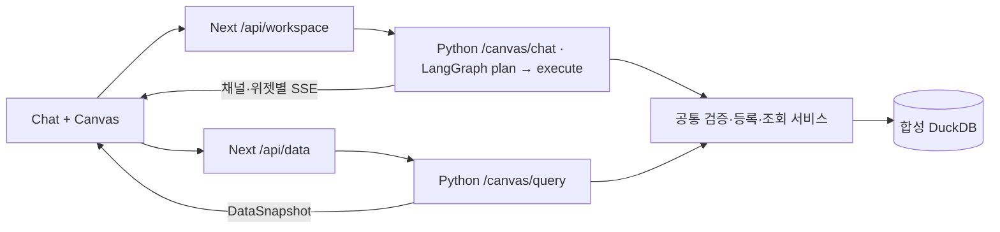

# 시스템 설계 — OpenUI Dynamic Canvas

## CANVAS-101 서비스 경계

Python 3.12/uv의 `backend-langgraph`와 Next.js 16.1.6/React 19.2.3/npm의 `frontend`는 독립 설치·빌드 프로젝트이며 런타임에 HTTP로만 연결한다. 포트는 각각 2037/3045다. reference와 형제 프로젝트 소스를 런타임에서 읽지 않는다.

기존 `/chat`은 `/api/chat` → LangGraph graph의 protocol v2 → AG-UI 경로를 유지한다. Canvas는 별도 SSE로 채널 분배를 담당하며 기존 AG-UI adapter를 수정하지 않는다.

## CANVAS-102 상태와 OpenUI

`src/canvas/model.ts`의 Zod 문서 v2에는 탭 배열·순서, widgetId 목록과 WidgetDefinition, active/selected ID가 있다. 위젯은 독립 program, queryId/version, parameters, bindingId, snapshot, uiState, layout, definitionRevision, renderer/catalog/result 계약을 가진다. 현재 renderer/catalog/query/result 계약은 1이다. DataBinding 필드는 위젯에 합쳐 저장한다. UI 명령과 AI 이벤트는 같은 applyCommand를 사용한다.

`store.ts`는 Zustand와 localStorage를 연결한다. 저장 키는 `canvas64:workspace:v2`, `canvas64:threads:v1`이며 원래 전체 Chat도 별도 canvas64 prefix를 쓴다. draft와 refresh runtime은 저장 문서와 분리한다. 미완성 생성은 정상 위젯으로 저장하지 않는다.

`render.tsx`는 원래 OpenUI 카탈로그에 CanvasData를 추가한다. CanvasData가 host context의 검증된 snapshot을 읽고 기존 Chart 또는 DataTable을 그린다. 데이터 갱신은 program 교체나 Renderer 재마운트 없이 이루어진다. Query/toolProvider를 갱신 수단으로 채택하지 않았다. null 포함 결과는 표로 표현하며 빈 결과를 명시한다. 프로그램 파싱·카탈로그 검증 후 완료 결과만 commit한다.

제목/차트 종류 변경은 해당 위젯 program을 다시 구성하고 마지막 snapshot·필터를 보존한다. Markdown 본문은 별도로 저장해 제목 변경 때 보존한다. 다른 위젯과 최신 layout/uiState는 유지한다. Add/drag는 deep copy와 새 widgetId를 사용한다. 임의 root 하위 그래프 추출은 하지 않는다.

## CANVAS-103 그래프·스트림·실패

`agent/canvas_graph.py`는 plan→execute StateGraph다. 모델이 구조화한 작업을 계획하고 SQL/작업 계약 오류를 최대 세 번 검증 피드백한다. describe_dataset / validate_analysis_query / execute_analysis_query / register_analysis_query는 공통 분석 서비스를 사용하는 도구다. 등록 도구가 최초 실행도 수행한다. 일반 UI 요청은 기존 전체 OpenUI prompt로 스트리밍한다.

이벤트에는 runId, sequence, requestId, channel, widgetId, baseRevision을 담는다. progress/tool/message/start/delta/complete/refreshed/command/failed/done/error를 분리한다. 분석 위젯의 OpenUI program은 검증된 계획에서 구성해 chunk로 전달하고, 일반 UI는 모델 token을 직접 전달한다. UI가 생성 중 상태를 보여주며 불완전 program을 영구 commit하지 않는다.

브라우저는 순서가 지난/중복 프레임과 중단된 요청을 무시한다. 위젯 수정은 definitionRevision 일치 여부를 검사한다. 사용자 중단은 fetch abort→SSE 연결 해제→LangGraph 취소로 전파된다. 모델 provider 내부 과금·처리 종료 시점까지 보장하지 않는다. 같은 Canvas에 제목이 중복되고 명시적 선택·ID·전체 변경 지시가 없으면 모델이 대상을 추정했더라도 변경을 중단하고 선택을 요청한다. 실패 작업의 구조화된 operation만 retryOperations로 다시 보내 성공한 카드를 중복 생성하지 않는다.

## DATA-101 DuckDB와 제한 실행

`analysis.py`가 deterministic seed, schema, SQL AST 검증, 파라미터 계산, 쿼리 등록과 조회를 소유한다. `sales_daily`는 day+region, `ad_daily`는 day+region+campaign이 고유 키다. 조회 worker가 원천 일자를 먼저 제한하고 month+region으로 각각 집계한 monthly_metrics를 결합해 중복 합산과 부분 월 오류를 방지한다.

SQLglot로 단일 SELECT, 허용 테이블/함수와 정확히 세 named parameter를 검증한다. DDL/DML, raw JOIN, 재귀, 외부 파일/네트워크, 설정·확장, 임의 함수는 거절한다. worker는 read-only DuckDB 연결에서 TEMP 데이터만 만들며 외부 접근 비활성, 1 thread, 128 MB, temp spill 0, 500행 제한을 사용한다. subprocess timeout 5초 시 실제 worker를 종료한다. Python RLock과 fcntl file lock으로 읽기와 관리용 correction을 직렬화한다. 운영 다중 writer 구성은 지원하지 않는다.

등록 쿼리는 `runtime/q_<sql-hash>.json`에 SQL·스키마·버전을 원자적으로 기록한다. 동일 ID의 SQL을 변경하지 않는다. `runtime/analytics.duckdb`, lock과 query 파일은 Git 제외다. `CANVAS_DATA_DIR`로 저장 디렉터리, `ANALYSIS_TODAY`로 테스트 UTC 날짜를 지정한다. seed/correct는 로컬 CLI 전용이다.

## FRESH-101 데이터 API와 최신성

`POST /canvas/query`는 queryId/queryVersion/parameters/requestId/definitionRevision을 받고 snapshot과 요청 식별자를 반환한다. 그래프·모델을 호출하지 않는다. snapshot은 columns/rows/types, canonical parameters와 hash, resolvedRange, dataVersion, sourceWatermark(revision/ingestedAt/throughDate), fetchedAt/expiresAt, rowCount/truncated/elapsedMs/provenance를 가진다.

refreshWidget은 같은 요청을 합치고 조건이 바뀌면 이전 fetch를 취소한다. 적용 시 요청 ID, 위젯 definitionRevision, queryVersion, 현재 parameters와 서버 parametersHash를 확인한다. result schema 변경은 Python에서 거절한다. 실패 시 이전 snapshot을 유지하고 표시 조건을 footer에 남긴다. 데이터만 바뀔 때 definitionRevision은 증가하지 않는다.

polling은 기본 비활성, 60초이며 document.hidden/offline/비활성 Canvas에서 쉬고 실패 후 120초 간격을 적용한다. snapshot 정책은 자동 조회하지 않는다. 상대 기간은 매번 서버 UTC 날짜로 계산하고 고정 범위는 ISO 날짜를 유지한다. TTL은 재조회 정책이며 원천 최신성 보증은 아니다. 과거 설명은 참조한 dataVersion과 연결한다.

## COMPAT-101 계약·검사·기존 UI

OpenUI lang-core/react-lang 1.0.1, react-ui/headless 0.18.1을 고정했다. 기존 src/lib·갤러리·미디어 API를 유지하며 chat-storage의 namespace만 격리했다. `npm run generate`와 `generate:canvas`의 prompt/spec을 개발 시 생성하고 두 prompt를 Python 패키지 자산으로 명시적으로 복사한다. 런타임의 cross-project 파일 접근은 없다.

문서 v1→v2는 명시적 fixture만 변환한다. 미지원 문서·renderer·catalog·result schema는 원본 보존과 읽기 전용 표로 복구한다. 패키지 업그레이드 전 저장 UI 회귀 검사가 필요하다. 자동 LLM 재생성으로 복원하지 않는다.

검사 명령과 실제 실행 결과는 [README](../../README.md), [현재 검증 기록](../flow/2026-10-18-canvas-implementation.md)을 따른다. 과거 복사된 flow 결과는 현재 결과가 아니다. Playwright MCP는 격리 Chrome을 실행하고 finally에서 browser_close 및 MCP 프로세스를 종료한다.

## 검증 현황

현재 구현 기준 Python 54 tests/Ruff, frontend 335 tests/typecheck/production build가 통과했다. ESLint는 오류 0개와 기존 경고 5개다. 실제 provider와 Playwright MCP로 생성·부분 수정·설명·전체 Canvas UX·데이터 갱신·실패·복원·모호한 대상 처리를 확인했다. 테스트 Chrome/MCP 종료 후 남은 프로세스는 0개였다. 자세한 재현 명령·증거·제한은 현재 flow를 따른다.
