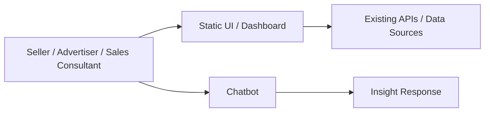
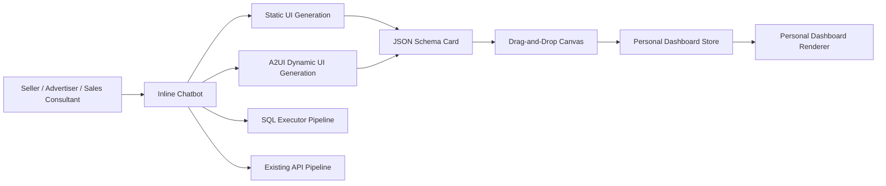
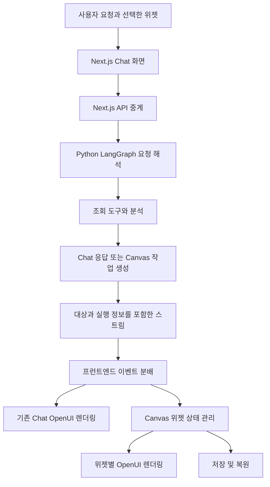
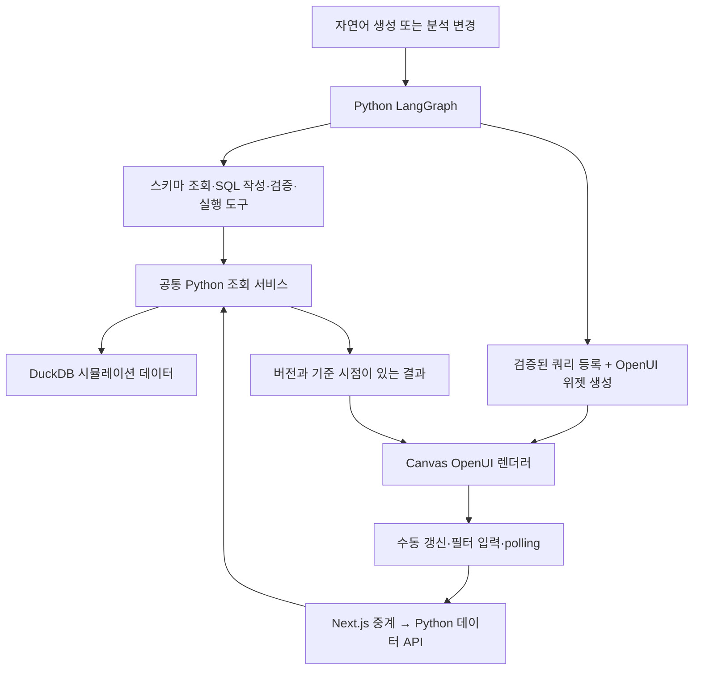

# Dynamic Canvas 기술 제안서

> 고객/사용자 경험을 먼저 정의하고, 그 경험을 만들기 위해 필요한 기술을 거꾸로 설계하는 제안서입니다.

---

## 0. 문서 정보

| 항목 | 내용 |
|---|---|
| 제안명 | Dynamic Canvas |
| 상태 | Draft |
| 작성일 / 목표일 | TBD / PoC 2주 내 완료 |

## 1. 한 문장 결정 요청

> 챗봇 대화 중 발견한 인사이트와 그래프를 사용자별 개인 대시보드로 저장하고 재조회할 수 있도록 동적 캔버스 렌더링 구조를 도입한다.

## 2. 작성 원칙

- 고객, 사용자, 운영자 중 누가 가장 큰 문제를 겪는지 먼저 정의한다.
- 현재 만들 수 있는 것보다 고객이 실제로 필요로 하는 결과를 먼저 쓴다.
- 장점뿐 아니라 비용, 리스크, 운영 부담, 롤백 계획을 함께 쓴다.
- 회의에서는 발표 전에 참석자가 문서를 먼저 읽고 질문한다.

---

# Part A. Working Backwards PR/FAQ

## 3. 미래 보도자료

### 3.1 제목

Dynamic Canvas: AI 대화에서 발견한 광고 인사이트를 개인 대시보드로 바로 저장

### 3.2 부제

셀러, Amazon 셀러 광고주, 세일즈 컨설턴트가 챗봇 분석 중 발견한 핵심 인사이트와 그래프를 놓치지 않고 업무 대시보드로 축적한다.

### 3.3 출시 요약

Dynamic Canvas는 셀러, Amazon 셀러 광고주, 세일즈 컨설턴트를 위한 AI 인사이트 대시보드 기능이다. 사용자는 챗봇과 대화하며 발견한 텍스트 인사이트, 표, 라인/바 차트, 광고 GMV 예측 카드를 개인 대시보드로 drag-and-drop 저장할 수 있다. 이를 통해 고객은 한정된 정적 화면이나 과도한 데이터 목록에 의존하지 않고, AI assistant와 데이터를 함께 활용해 의미 있는 광고/매출 인사이트를 발굴하고 재사용한다.

### 3.4 고객 문제

현재 고객은 정적 UI와 고정된 대시보드에서 제공되는 제한적인 정보만 확인할 수 있다. 정보를 더 많이 제공하면 고객은 수많은 데이터 속에서 직접 인사이트를 찾아야 하고, 반대로 제품/개발팀이 좋은 정보만 선별해 계속 제공하려면 높은 리소스 부담이 발생한다.

- 현재 고객은 정적 화면과 고정된 리포트 때문에 개별 상황에 맞는 인사이트를 즉시 축적하기 어렵다.
- 이 문제는 광고 성과 점검, GMV 예측, 캠페인 예산 판단, 세일즈 컨설팅 리포트 준비 과정에서 반복된다.
- 기존 대안은 정적 대시보드 확장 또는 생성형 BI 툴이지만, 정적 대시보드는 유연성이 낮고 생성형 BI 툴은 제품 경험 안에서 챗봇 대화와 자연스럽게 연결되기 어렵다.

### 3.5 제안 솔루션

Dynamic Canvas는 챗봇 메시지 안의 특정 카드를 저장 가능한 UI 블록으로 만들고, 사용자가 필요한 카드만 개인 대시보드로 옮길 수 있게 한다. 시스템은 Static UI Generation과 A2UI 기반 Dynamic UI Generation을 함께 사용해 JSON schema 기반 UI를 생성하고, drag-and-drop canvas 시스템으로 저장/재조회 경험을 제공한다.

- 고객은 앞으로 챗봇 대화 중 의미 있는 인사이트, 표, 그래프, 광고 GMV 예측 카드를 개인 대시보드에 저장할 수 있다.
- 시스템은 inline chatbot 안에서 정적/동적 UI 카드를 생성하고, 저장 가능한 카드 schema와 canvas renderer를 통해 재사용 가능한 화면을 구성한다.
- 운영자는 모든 고객 요구를 정적 화면으로 미리 구현하지 않고도 고객별 분석 흐름을 지원할 수 있다.

## 4. 핵심 FAQ

### Q1. 누가 이 제안의 주 고객인가?

주 고객은 셀러, Amazon 셀러 광고주, 세일즈 컨설턴트다. 이들은 광고 성과와 매출 흐름을 자주 확인하고, 챗봇 분석 과정에서 발견한 내용을 이후 업무 판단이나 고객 커뮤니케이션에 재사용해야 한다.

### Q2. 고객은 이 제안을 사용하면 무엇을 더 잘하게 되는가?

고객은 AI assistant와 대화하며 발견한 광고/매출 인사이트를 일회성 답변으로 소비하지 않고 개인 대시보드에 축적할 수 있다. 특히 캠페인 점검, 예산 변경 검토, GMV 예측 확인, 컨설팅 리포트 준비에 필요한 근거를 더 쉽게 다시 찾을 수 있다.

### Q3. 성공하면 어떤 지표가 바뀌어야 하는가?

| 지표 | 현재값 | 목표값 | 측정 방법 |
|---|---:|---:|---|
| 대시보드 저장률 | TBD | TBD | 챗봇 응답 중 인사이트/그래프 카드가 대시보드로 저장된 비율 |
| 저장 콘텐츠 재방문율 | TBD | TBD | 저장된 카드가 일정 기간 내 다시 열린 비율 |
| 챗봇 분석 세션 전환율 | TBD | TBD | 일반 질의 대비 광고/매출 분석 목적 세션 비율 |
| 의사결정 액션 연결률 | TBD | TBD | 저장된 인사이트 이후 예산 변경, 캠페인 점검, 리포트 작성 등 후속 행동으로 이어진 비율 |

### Q4. 왜 지금 해야 하는가?

고객에게 제공해야 할 광고/매출 데이터와 인사이트 요구는 계속 늘어나지만, 모든 요구를 정적 UI로 구현하는 방식은 제품/개발팀 리소스를 빠르게 소모한다. 동시에 단순히 데이터를 많이 노출하는 방식은 고객이 핵심 인사이트를 찾기 어렵게 만든다. 챗봇 기반 분석 경험과 동적 캔버스를 결합하면, 고객이 필요한 순간에 필요한 카드만 선택해 개인 대시보드로 축적하는 제품 경험을 만들 수 있다.

### Q5. 이번 제안에서 하지 않는 것은 무엇인가?

- 포함하지 않음: 실시간 데이터 갱신, 고성능 렌더링 최적화, 비용 감소, 대시보드 정렬/편집/공유/리포트 생성
- 다음 단계 후보: 저장된 카드 편집, 공유 대시보드, 리포트 생성, 팀/계정 단위 대시보드, 고도화된 BI 탐색 기능

---

# Part B. 6페이지 내러티브 기술 제안

## 5. 요약

Dynamic Canvas는 챗봇 대화 중 생성된 인사이트와 그래프 카드를 사용자별 개인 대시보드로 저장하고 재조회할 수 있게 하는 동적 캔버스 렌더링 구조다. 주 고객은 셀러, Amazon 셀러 광고주, 세일즈 컨설턴트이며, 이들은 정적 UI의 제한성과 과도한 데이터 노출 사이에서 업무에 필요한 인사이트를 찾는 데 어려움을 겪는다. 본 제안은 Static UI Generation과 A2UI 기반 Dynamic UI Generation, JSON schema 기반 UI 생성, drag-and-drop canvas 시스템을 결합해 MVP를 검증한다. 의사결정 요청은 Dynamic Canvas PoC를 2주 안에 완료하고, 동적 캔버스 렌더링 구조 도입 여부를 판단하는 것이다.

## 6. 현재 상태와 한계

### 6.1 현재 고객/사용자 흐름

1. 고객은 정적 대시보드 또는 고정 UI에서 광고/매출 데이터를 확인한다.
2. 필요한 정보가 없으면 챗봇이나 별도 분석 흐름을 통해 추가 질문을 한다.
3. 챗봇에서 얻은 인사이트나 그래프는 대화 안에 남아 있으며, 개인 업무 대시보드로 축적하기 어렵다.
4. 고객 또는 세일즈 컨설턴트는 이후 판단이나 리포트 준비 시 같은 정보를 다시 찾거나 재생성해야 한다.

### 6.2 현재 시스템



### 6.3 현재 방식의 한계

| 한계 | 고객/사업 영향 | 기술 원인 | 근거 |
|---|---|---|---|
| 제공 정보가 제한적임 | 고객별 상황에 맞는 인사이트를 화면에서 바로 얻기 어렵다 | 정적 UI 중심으로 화면과 데이터를 사전에 정의해야 함 | 고객 요구와 분석 케이스가 다양함 |
| 정보를 많이 제공하면 탐색 부담이 커짐 | 고객이 데이터 속에서 직접 인사이트를 찾아야 한다 | 대시보드가 사용자별 맥락을 반영하지 못함 | 광고/매출 분석 세션에서 질문이 반복됨 |
| 좋은 정보를 매번 제품화하기 어려움 | 제품/개발팀 리소스가 부족해 대응 속도가 느려진다 | 카드/차트/리포트를 정적 기능으로 개별 개발해야 함 | 요구사항 증가 대비 개발 비용 증가 |
| 챗봇 인사이트가 축적되지 않음 | 유용한 답변이 일회성으로 소비된다 | 채팅 응답과 대시보드 저장 모델이 분리되어 있음 | 재방문, 리포트, 의사결정 연결이 어려움 |

## 7. 목표와 성공 기준

### 목표

- 고객 가치 목표: 챗봇에서 발견한 인사이트를 개인 대시보드에 저장하고 다시 확인할 수 있게 한다.
- 사업/조직 목표: 모든 고객 요구를 정적 UI로 사전 개발하지 않고도 광고/매출 분석 경험을 확장한다.
- 기술 품질 목표: 텍스트 인사이트, 표, 라인/바 차트, 광고 GMV 예측 카드를 JSON schema 기반으로 렌더링한다.
- 운영 목표: SQL executor 방식과 기존 API 연동 방식의 데이터 조회 파이프라인을 비교해 PoC 이후 확장 방향을 결정한다.

### 비목표

- 실시간 데이터 갱신 기능은 MVP에서 제공하지 않는다.
- 고성능 렌더링 최적화는 MVP의 목표가 아니다.
- 비용 감소는 이번 제안의 직접 목표가 아니다.
- 대시보드 정렬, 편집, 공유, 리포트 생성은 MVP 범위에서 제외한다.

### 성공 기준

| 기준 | 목표 | 측정 방식 |
|---|---:|---|
| 대시보드 저장률 | TBD | 챗봇 응답 중 인사이트/그래프 카드가 대시보드로 저장된 비율 |
| 저장 콘텐츠 재방문율 | TBD | 저장된 카드가 일정 기간 내 다시 열린 비율 |
| 챗봇 분석 세션 전환율 | TBD | 일반 질의 대비 광고/매출 분석 목적 세션 비율 |
| 의사결정 액션 연결률 | TBD | 저장 이후 예산 변경, 캠페인 점검, 리포트 작성 등 후속 행동 추적 |

## 8. 제안 솔루션

### 8.1 핵심 아이디어

Dynamic Canvas는 챗봇 응답을 단순 텍스트가 아니라 저장 가능한 UI 카드 단위로 다룬다. 챗봇은 메시지 안에서 특정 카드를 생성하고, 사용자는 이 카드 중 필요한 것만 drag-and-drop으로 사용자별 개인 대시보드에 저장한다.

기술적으로는 Static UI Generation과 A2UI 기반 Dynamic UI Generation을 병행한다. 각 카드는 JSON schema로 표현되며, canvas renderer는 schema를 해석해 텍스트 인사이트, 표, 라인/바 차트, 광고 GMV 예측 카드를 렌더링한다. 데이터 조회 파이프라인은 SQL executor 방식과 기존 API 연동 방식을 PoC에서 비교한다.

### 8.2 목표 아키텍처



### 8.3 주요 변경점

| 영역 | 현재 | 변경 후 | 기대 효과 |
|---|---|---|---|
| 챗봇 응답 | 텍스트 또는 일회성 응답 중심 | 메시지 안의 특정 카드를 저장 가능한 단위로 생성 | 유용한 인사이트를 재사용 가능 |
| UI 생성 | 정적 UI 중심 | Static UI Generation + A2UI Dynamic UI Generation | 고객별 맥락에 맞는 카드 생성 |
| 렌더링 | 사전 구현된 화면 중심 | JSON schema 기반 카드 renderer | 텍스트, 표, 차트, 예측 카드 확장 가능 |
| 대시보드 | 고정 화면 중심 | 사용자별 개인 Dynamic Canvas | 필요한 인사이트만 개인화 저장 |
| 데이터 조회 | 기존 API 중심 | SQL executor 방식과 기존 API 방식 비교 | PoC 이후 확장 가능한 데이터 파이프라인 선택 |

### 8.4 운영 모델

| 영역 | 제안 내용 |
|---|---|
| 배포 | 개발자 데모 이후 내부 세일즈, 베타, 전체 출시 순서로 단계적 공개 |
| 모니터링/알림 | 저장률, 재방문율, 분석 세션 전환율, 의사결정 액션 연결률 추적 |
| 장애 대응 | 카드 생성 실패 시 기본 텍스트 응답으로 폴백하고, 저장 실패 시 재시도 가능한 상태를 제공 |
| 비용 관리 | AI UI 생성, 데이터 조회, GMV 예측 카드 생성 비용을 PoC에서 측정 |

## 9. 대안 검토

| 대안 | 장점 | 단점 | 결정 |
|---|---|---|---|
| Option A: Dynamic Canvas | 챗봇 대화와 개인 대시보드를 자연스럽게 연결하고, 필요한 인사이트만 저장 가능 | schema 품질, 레이턴시, 보안, 데이터 정확도 검증 필요 | 선택 |
| Option B: 생성형 BI 툴 | 탐색 자유도가 높고 다양한 분석 화면 생성 가능 | 제품 내 챗봇 대화 흐름과 분리될 수 있고, MVP 범위가 커질 가능성이 높음 | 보류 |
| Option C: 기존 정적 대시보드 확장 | 구현 방식이 익숙하고 운영 리스크가 낮음 | 고객별 요구를 계속 정적 기능으로 개발해야 하며 리소스 부담이 지속됨 | 기각 |
| Option D: Do nothing | 구현 비용 없음 | 정적 UI의 한계와 챗봇 인사이트의 일회성 문제가 지속됨 | 기각 |

선택한 이유:
Dynamic Canvas는 현재 제품 경험 안에서 챗봇과 대시보드를 연결하면서도, 생성형 BI 툴보다 작은 MVP 범위로 검증할 수 있다. 또한 정적 대시보드 확장보다 고객별 인사이트 요구에 유연하게 대응할 수 있고, 2주 PoC 안에서 핵심 가정인 카드 생성, 저장, 재조회, canvas UX를 확인할 수 있다.

## 10. 리스크와 검증 계획

| 항목 | 내용 | 대응 |
|---|---|---|
| 핵심 가정 | 사용자는 챗봇 메시지 안의 특정 카드를 개인 대시보드에 저장하고 재방문할 가치가 있다 | 개발자 데모와 내부 세일즈 검증에서 저장률과 재방문 의도를 확인 |
| 비용 리스크 | AI UI 생성, 데이터 조회, 광고 GMV 예측 카드 생성 비용이 증가할 수 있다 | PoC에서 카드 생성당 비용과 데이터 조회 비용을 측정 |
| 레이턴시 리스크 | 챗봇 응답, 데이터 조회, UI 생성, canvas 저장까지의 응답 시간이 길어질 수 있다 | static/dynamic generation 경로별 latency를 측정하고 폴백 응답을 둔다 |
| 데이터 정확도 리스크 | SQL executor 또는 기존 API 조회 결과, GMV 예측, AI 설명의 정확도 검증이 필요하다 | SQL executor 방식과 기존 API 연동 방식을 비교하고, 예측 카드에는 근거 데이터와 생성 시점을 표시 |
| 보안/개인정보 | 사용자별 개인 대시보드에 광고/매출 데이터가 저장되며 권한 누락 시 데이터 노출 가능성이 있다 | 사용자 권한 기반 저장/조회, 데이터 범위 검증, 민감 데이터 마스킹 정책을 PoC 설계에 포함 |
| 운영 리스크 | 카드 schema 변경 또는 renderer 오류로 저장된 카드가 깨질 수 있다 | schema versioning과 renderer fallback을 설계한다 |

## 11. 실행과 출시 계획

### 11.1 마일스톤

| 단계 | 산출물 | 종료일 | 승인 기준 |
|---|---|---|---|
| PoC 설계 | 카드 schema 초안, 렌더러 범위, 데이터 파이프라인 비교 기준 | Day 2 | 텍스트/표/차트/GMV 예측 카드 요구사항 합의 |
| 데이터 파이프라인 검증 | SQL executor 방식과 기존 API 연동 방식의 비교 결과 | Day 5 | 최소 1개 광고/매출 분석 시나리오에서 데이터 조회 가능 |
| Inline chatbot UI generation | Static UI Generation 및 A2UI Dynamic UI Generation 데모 | Day 8 | 챗봇 메시지 안에서 4개 MVP 블록 타입 생성 가능 |
| Canvas UX 검증 | drag-and-drop 저장 및 개인 대시보드 재조회 데모 | Day 11 | 메시지 안의 특정 카드 저장/재조회 가능 |
| 개발자 데모 | End-to-end PoC 데모와 리스크 리포트 | Day 14 | 내부 세일즈 검증으로 진행 여부 결정 |
| 내부 세일즈 검증 | 세일즈 컨설턴트 피드백 | TBD | 베타 범위와 개선 우선순위 결정 |
| 베타 | 일부 셀러/광고주 대상 베타 | TBD | 성공 지표 측정 가능 |
| 전체 출시 | 전체 사용자 공개 | TBD | 보안, 정확도, 운영 기준 충족 |

### 11.2 의존성과 롤백

| 구분 | 내용 | 기한/조건 |
|---|---|---|
| 의존성 | 챗봇 응답에서 카드 단위 metadata를 생성할 수 있어야 한다 | PoC 설계 단계 |
| 의존성 | SQL executor 또는 기존 API 기반 데이터 조회 경로 중 최소 1개가 MVP 데이터를 제공해야 한다 | Day 5 |
| 의존성 | 개인 대시보드 저장소와 사용자별 접근 권한 모델이 필요하다 | Day 11 |
| 롤백 조건 | 카드 생성 품질, 레이턴시, 데이터 정확도, 보안 검증 중 핵심 기준을 충족하지 못함 | 개발자 데모 전후 |
| 롤백 조치 | Dynamic Canvas 저장 기능을 비활성화하고 챗봇 기본 응답 또는 정적 카드 렌더링으로 폴백 | 즉시 |

## 12. 미해결 질문과 의사결정 기록

| 구분 | 내용 | 기한/날짜 |
|---|---|---|
| 미해결 질문 | 성공 지표별 목표값을 어떤 baseline으로 설정할 것인가 | PoC 이후 |
| 미해결 질문 | SQL executor 방식과 기존 API 연동 방식 중 MVP 이후 표준 데이터 파이프라인은 무엇인가 | Day 5 |
| 미해결 질문 | 광고 GMV 예측 카드의 신뢰도 기준과 설명 방식은 어떻게 정의할 것인가 | PoC 기간 |
| 미해결 질문 | 개인 대시보드에 저장되는 데이터의 보존 기간과 삭제 정책은 무엇인가 | 베타 전 |
| 결정 기록 | Dynamic Canvas를 제안명으로 사용한다 | 2026-06-25 |
| 결정 기록 | 작성 조직, 책임자, 의사결정자 항목은 문서 정보에서 제거한다 | 2026-06-25 |
| 결정 기록 | PoC 목표 일정은 2주로 설정한다 | 2026-06-25 |

---

# Part C. 리뷰 운영

## 13. 리뷰 미팅 방식

1. 20-30분 동안 모두가 조용히 문서를 읽고 코멘트를 단다.
2. 작성자는 발표하지 않고 질문을 받는다.
3. 참석자 전원이 총평을 말한다.
4. 가장 senior한 참석자는 마지막에 말한다.
5. 마지막 10분에 결정, 보류 사유, 다음 액션을 확정한다.

## 14. 품질 체크리스트

- [x] 고객/사용자가 명확하다.
- [x] 고객 문제가 고객 관점으로 쓰였다.
- [x] 성공 기준이 측정 가능한 지표로 정의됐다.
- [x] 대안과 trade-off가 명확하다.
- [x] 보안, 개인정보, 운영, 비용 영향이 포함됐다.
- [ ] 마이그레이션과 롤백 계획이 있다.
- [x] 핵심 가정과 검증 방법이 있다.
- [x] 미해결 질문과 의사결정 기한이 명확하다.

---

# Part D. 부록

## A. 근거 데이터

- 사용자 인터뷰: TBD
- VOC: TBD
- 챗봇 분석 로그: TBD
- 대시보드 사용 로그: TBD
- 데이터 조회 및 UI 생성 벤치마크: PoC 기간 측정


---

## B. Chat + Canvas 사용자 요청 목록 (2026-10-18 초안)

기존 Chat의 OpenUI 응답을 유지하면서, 사용자가 대화로 Canvas 생성과 수정을 요청할 수 있도록 출력 채널을 확장한다. Python LangGraph 사용과 Chat·Canvas 양쪽의 OpenUI 렌더링은 필수 전제다. 아래 목록은 사용자 경험과 기대 결과를 정의하는 요구사항 초안이며, 구현 완료나 전체 MVP 포함을 뜻하지 않는다. 스트리밍 전송 방식과 저장 형식은 후속 설계에서 결정한다.

범위 표기: **핵심**은 이번 대화에서 정한 방향, **후보**는 추가 검토할 사용자 기능, **후속**은 초기 검증 이후의 확장이다. 기존 본문의 편집 제외 범위는 아래 핵심 요구사항인 특정 차트의 부분 수정에 한해 확장한다. 정렬·공유·리포트 등 다른 항목은 아직 포함하기로 결정하지 않았다. 기존 본문에 등장하는 A2UI와 JSON schema 생성 방식은 이번 OpenUI 기반 확장의 확정 구현 방식으로 간주하지 않는다.

| ID | 사용자 요청 예시 | 사용자가 기대하는 결과 | 범위 |
|---|---|---|---|
| CHAT-01 | “지난달 매출을 차트로 보여줘.” | 별도 Canvas 지시가 없으면 기존처럼 Chat 안에서 OpenUI 차트를 보여준다. | 핵심 |
| CHAT-02 | “이 결과를 표로 보여줘.” | Chat에서 기존 대화 맥락을 사용해 표를 보여준다. Canvas는 바꾸지 않는다. | 핵심 |
| CHAT-03 | “매출이 줄어든 이유를 설명해줘.” | Chat에서 분석과 근거를 설명한다. 단순 질문을 Canvas 수정으로 처리하지 않는다. | 핵심 |
| CANVAS-01 | “이번 달 매출 차트를 canvas에 만들어줘.” | Canvas 영역에 새 차트를 생성하고, Chat에는 작업 결과를 안내한다. | 핵심 |
| CANVAS-02 | “매출과 광고비 차트를 캔버스에 각각 만들어줘.” | Canvas에 서로 구분되는 두 차트를 생성한다. 이후 각각을 지정해 수정할 수 있다. | 핵심 |
| CANVAS-03 | “설명은 채팅에, 비교 차트는 canvas에 보여줘.” | 한 요청의 설명은 Chat에, 차트는 Canvas에 표시한다. | 핵심 |
| CANVAS-04 | “캔버스에 있는 매출 차트가 무슨 뜻인지 설명해줘.” | Canvas를 읽고 Chat에서 설명한다. ‘캔버스’라는 단어가 있다는 이유만으로 생성·수정하지 않는다. | 핵심 |
| CANVAS-05 | “아까 만든 매출 차트 옆에 광고비 차트도 추가해줘.” | 기존 차트를 유지하면서 새 차트를 추가한다. ‘옆’이라는 배치 지시 지원 여부는 별도 검토한다. | 후보 |
| CANVAS-06 | “채팅에 나온 이 차트를 캔버스에 저장해줘.” | 선택한 차트를 Canvas에 다시 표시하고 원래 Chat 응답은 유지한다. 응답 일부 추출과 독립 카드 전송 중 지원 방식을 검증해야 한다. | 후보 |
| CANVAS-07 | “광고 성과 요약과 표도 캔버스에 추가해줘.” | 차트 이외의 요약·표를 별도 항목으로 생성한다. | 후보 |
| CANVAS-08 | “광고 GMV 예측을 캔버스에 보여줘.” | 예측임을 구분하고 기준 기간·입력 데이터·가정을 함께 표시한다. 근거가 없으면 임의의 실제 예측처럼 제시하지 않는다. | 후보 |
| STREAM-01 | “차트가 만들어지는 대로 보여줘.” | 전체 작업이 끝나기 전에도 Chat과 Canvas에서 각 결과의 생성 진행을 확인할 수 있다. | 핵심 |
| STREAM-02 | “설명하면서 캔버스 차트도 만들어줘.” | 설명과 차트가 각각 올바른 영역에 누적된다. 실제 동시 생성 여부와 무관하게 내용이 서로 섞이지 않는다. | 핵심 |
| STREAM-03 | “차트 세 개를 만들어줘. 완성된 것부터 보여줘.” | 위젯마다 생성 중·완료·실패 상태를 구분한다. 한 차트의 실패로 다른 완성된 차트가 사라지지 않는다. | 후보 |
| STREAM-04 | “지금 만드는 차트는 중단해줘.” | 지정한 생성 작업을 중단한다. 이미 저장된 다른 차트는 유지하고 미완성 결과를 완료로 표시하지 않는다. | 후보 |
| STREAM-05 | “실패한 광고비 차트만 다시 만들어줘.” | 실패한 대상만 재시도하고, 성공한 차트를 중복 생성하지 않는다. | 후보 |
| PATCH-01 | “매출 차트의 기간을 최근 3개월로 바꿔줘.” | 해당 차트의 조회 범위와 데이터를 바꾸고 다른 차트는 유지한다. | 핵심 |
| PATCH-02 | “매출 차트에서 한국 데이터만 보여줘.” | 지정한 차트에 지역 조건을 적용하고 적용된 조건을 확인할 수 있게 한다. | 핵심 |
| PATCH-03 | “매출 차트에 지난달 데이터도 추가해줘.” | 대상 차트의 해당 기간 데이터만 추가·갱신한다. 이미 있는 기간을 중복해서 넣지 않는다. | 핵심 |
| PATCH-04 | “이 차트의 3월 값을 120으로 바꿔서 가정해줘.” | 대상 값만 바꾼 가정 결과를 표시한다. 원본 업무 데이터를 수정하지 않으며 실제 조회 결과와 구분한다. | 후보 |
| PATCH-05 | “매출 차트를 막대 대신 선으로 바꿔줘.” | 대상 차트의 표현만 바꾸고 데이터·필터 조건은 유지한다. | 후보 |
| PATCH-06 | “이 차트 제목을 ‘2026년 월별 매출’로 바꿔줘.” | 지정한 제목만 바꾸고 나머지 내용은 유지한다. | 후보 |
| PATCH-07 | “광고비 차트만 최신 데이터로 다시 조회해줘.” | 사용자가 요청한 시점에 해당 데이터만 갱신하고 기준 시점을 표시한다. 자동 실시간 갱신과는 구분한다. | 후보 |
| PATCH-08 | “두 차트 모두 같은 기간으로 맞춰줘.” | 사용자가 지정한 차트들에만 기간을 적용하고 대상별 성공·실패를 알려준다. | 후보 |
| CONTEXT-01 | “이 차트만 바꿔줘.” | 현재 선택한 차트를 대상으로 삼는다. 선택이 없고 후보가 여러 개면 어느 차트인지 확인한다. | 핵심 |
| CONTEXT-02 | “매출 차트를 수정해줘.” | 같은 이름의 차트가 여러 개이거나 수정 내용이 빠졌으면 필요한 조건을 확인하고 임의로 변경하지 않는다. | 핵심 |
| CONTEXT-03 | “방금 요청한 기간 말고 최근 6개월로 바꿔줘.” | 동일 대상의 새 요청을 식별하고 늦게 도착한 이전 결과가 최신 결과를 덮어쓰지 않도록 한다. | 후보 |
| CONTEXT-04 | “그 차트를 채팅에서 설명하고, 캔버스에는 그대로 둬.” | 읽기 요청과 변경 요청을 구분하고 Canvas 상태를 유지한다. | 핵심 |
| SAVE-01 | “이 캔버스를 저장해줘.” | 저장 성공 여부를 알려주고, 다시 열 때 완료된 차트와 표시 데이터를 복원한다. 저장 범위가 브라우저인지 계정인지 명확히 안내한다. | 후보 |
| SAVE-02 | “아까 저장한 캔버스를 다시 열어줘.” | 저장된 구성을 복원하며 재조회 요청이 없는 한 다른 데이터로 조용히 바꾸지 않는다. | 후보 |
| SAVE-03 | “새로고침해도 지금 차트들을 볼 수 있게 해줘.” | 완료된 항목을 복원하고 생성 중이던 항목은 완료된 항목과 구분한다. | 후보 |
| MANAGE-01 | “매출 차트를 맨 위로 옮겨줘.” | 데이터 변경 없이 배치만 바꾼다. | 후보 |
| MANAGE-02 | “광고비 차트만 캔버스에서 지워줘.” | 대상 항목만 제거하고 다른 차트와 원본 업무 데이터는 유지한다. | 후보 |
| MANAGE-03 | “방금 변경한 차트를 이전 상태로 되돌려줘.” | 대상 차트의 이전 상태를 복원한다. 되돌릴 수 없는 경우 이유를 알린다. | 후속 |
| MANAGE-04 | “이 캔버스를 복사해서 다른 시나리오로 만들어줘.” | 원본을 보존한 별도 Canvas를 만든다. | 후속 |
| SHARE-01 | “이 캔버스를 팀원에게 공유해줘.” | 접근 권한과 공유 범위를 지정할 수 있다. 초기 검증 범위에서는 제외한다. | 후속 |
| SHARE-02 | “이 캔버스로 보고서를 만들어줘.” | 차트·설명·출처·기준 시점을 포함한 보고서를 만든다. 초기 검증 범위에서는 제외한다. | 후속 |

공통 기대 동작은 다음과 같다.

- ‘canvas’, ‘캔버스’와 명확한 후속 지시를 이해하되, 단어의 존재만으로 출력 채널이나 변경 여부를 결정하지 않는다.
- Chat의 기존 OpenUI 응답과 Canvas의 생성·수정 결과는 서로 다른 표시 영역에서 유지된다.
- 부분 수정은 사용자 관점에서 대상 차트에만 반영되어야 한다. 이는 DOM 일부만 변경해야 한다는 구현 제약을 뜻하지 않는다.
- 차트 수정이 실패하면 기존의 정상 결과를 유지하고, 실패한 대상과 재시도 가능 여부를 알려준다.
- 데이터가 없거나 조회에 실패하면 빈 결과·실패를 구분한다. 근거 없는 숫자를 실제 데이터처럼 채우지 않는다.
- 저장·조회 시 사용자별 데이터 범위를 지킨다. 브라우저 로컬 저장을 계정 기반 개인 대시보드 저장으로 설명하지 않는다.
- 스트리밍 연결 수, 동시 실행 수, 카드 저장 형식, OpenUI 상태 연결 방식은 이 사용자 요구사항 목록에서 확정하지 않는다.

첫 검증 시나리오는 “지난달 매출을 채팅에 보여줘 → 매출과 광고비 차트를 canvas에 각각 만들어줘 → 설명은 채팅에 계속 보여줘 → 매출 차트만 최근 3개월로 바꿔줘”로 한다. 기존 Chat 동작 유지, 채널별 진행 표시, 두 차트의 독립성, 대상 차트만 수정되는지를 확인한다. 저장·복원과 취소·재시도는 다음 검증 후보로 둔다.


---

## C. Chat + Canvas 설계 및 구현 계획 (2026-10-18 초안)

### C.1 계획의 목적과 현재 상태

사용자 요청 목록 B를 구현하기 전에, 기존 Chat을 보존하면서 Canvas를 확장할 수 있는 구조와 검증 순서를 정한다. 이 섹션은 설계 초안이며 기술 검증 통과 또는 구현 완료를 의미하지 않는다. B의 핵심·후보·후속 구분을 유지한다. ‘바로 구현 가능’은 별도 선행 기술 실험 없이 일반적인 개발과 테스트로 진행할 수 있다는 뜻이며, 후보 기능의 MVP 포함을 자동으로 확정하지 않는다.

- 기반: `6-3-langgraph-platform-to-intelligent-ui`의 프로젝트 파일을 현재 프로젝트로 복사했다.
- 환경: 백엔드 `.env`는 `6-2-langgraph-platform-to-py-document`에서, 프런트엔드 `.env`는 `6-3`에서 복사했다. 실제 키는 출력하거나 커밋하지 않는다.
- 현재 미완료: 프로젝트 전용 이름·포트·환경 URL 조정, 의존성 설치, 현재 경로에서의 실행 검증, Canvas 기능 구현.
- `docs/stock/`, 기존 flow, README, Report와 AGENTS에 남아 있는 포트·프로젝트 설명·테스트 결과는 복사 원본의 정보다. 이를 `6-4`의 검증 결과로 간주하지 않는다.
- `reference/`의 기존 Tambo PoC는 UX와 상태 관리의 참고 자료로 보존한다. 새 프로젝트가 런타임에 참고 프로젝트의 파일이나 모듈을 읽지 않는다.
- 이번 문서 변경은 계획을 이 파일 끝에 추가하는 데 한정한다. 구현 단계부터 확정 설계를 `docs/stock/business.md`, `docs/stock/system.md`에 반영하고, 검증 결과와 변경 이유를 `docs/flow/`에 날짜별로 기록한다. 과거 기록은 덮어쓰지 않는다.

### C.2 확정 전제와 설계 제안

| 구분 | 내용 |
|---|---|
| 확정 전제 | 모델 실행과 데이터 조회·분석은 Python LangGraph가 담당한다. |
| 확정 전제 | 기존 Chat의 OpenUI 렌더링 기능을 유지한다. Canvas도 OpenUI로 렌더링한다. |
| 확정 전제 | 사용자는 Chat에서 Canvas 생성·조회·수정을 요청한다. 단어 매칭만으로 변경을 실행하지 않는다. |
| 확정 전제 | Canvas의 여러 차트를 구분하고 지정한 차트만 수정할 수 있어야 한다. |
| 설계 제안 | Canvas 위젯마다 독립 OpenUI 프로그램과 고유 ID를 갖는다. 각 프로그램은 자체 root를 가진다. |
| 설계 제안 | 최초 PoC는 하나의 전송 연결에서 Chat·Canvas 이벤트를 구분한다. 실제 병렬 모델 실행은 선행 조건이 아니다. |
| 설계 제안 | 데이터 변경과 UI 표현 변경을 별도 작업으로 다루고, 수정 결과를 검증한 뒤 정상 버전으로 확정한다. |
| 미확정 | 기존 AG-UI adapter를 통해 Canvas 이벤트를 전달하는 방법, OpenUI 데이터 연결 방식, 저장 위치와 버전 정책. 기술 실험 결과로 결정한다. |

### C.3 목표 구조와 책임



- Python은 요청을 설명·생성·데이터 변경·표현 변경으로 분류하고, 필요한 데이터를 조회하며 대상과 변경 내용을 구조화한다. 사용자 의도가 모호하면 Chat으로 확인한다.
- Next.js는 브라우저와 Python 사이의 요청·스트림 중계를 담당한다. 모델 실행이나 API 키 관리를 프런트엔드로 옮기지 않는다.
- Chat은 기존 OpenUI 응답과 작업 안내를 표시한다. Canvas 코드 조각이 Chat의 OpenUI 문자열에 섞이지 않도록 한다.
- Canvas 호스트는 위젯 ID, 선택, 배치, 상태, 버전, 저장을 관리한다. OpenUI 렌더러는 해당 위젯의 표현을 담당한다.
- 서버는 클라이언트가 보낸 선택 ID·상태를 그대로 신뢰하지 않고 요청 대상과 데이터 범위를 검증한다. 계정 기능을 추가할 때 소유권 검증도 연결한다.
- 두 채널의 존재와 두 모델 실행의 병렬화는 별개다. 첫 구현은 순차 생성도 허용하되 전송 중 각 결과를 점진적으로 표시한다.

### C.4 상태와 이벤트의 개념 계약

아래는 설계에 필요한 정보이며 확정 API 명세는 아니다. 구체적인 필드 타입과 스키마는 기술 검증 이후 정한다.

| 대상 | 관리할 정보 | 목적 |
|---|---|---|
| Canvas | canvasId, 이름, 위젯 목록·순서, 선택한 위젯 | 화면 구성과 사용자 지시 대상 식별 |
| Widget | widgetId, 제목, OpenUI 프로그램, 표시 데이터 또는 snapshot, 입력 상태, revision, 형식·라이브러리 버전 | 독립 렌더링과 복원 |
| 데이터 근거 | 출처, 조회 조건, 기준 시점, 실제·mock·가정 구분 | 부분 수정 시 의미와 근거 보존 |
| 실행 | runId, operationId, 대상, 상태, 오류 | 생성·수정·취소·재시도 구분 |
| 스트림 이벤트 | channel, runId, operationId, widgetId(Canvas 대상일 때), sequence, baseRevision, type, payload | 채널 분리·순서·중복·충돌 처리 |

Canvas 이벤트 종류의 후보는 시작, 프로그램 조각, 수정 제안, 완료, 실패, 취소다. ‘완료’는 파싱과 스키마 검증을 통과한 위젯을 확정하는 시점으로 정의한다. 중간 조각을 최종 결과로 저장하지 않는다. 불완전한 JSON 변경을 조각마다 바로 적용하지 않는다.

프런트엔드는 채널·실행·위젯별 버퍼를 관리한다. 기존 Chat 이벤트 계약은 유지하고 Canvas 이벤트만 별도 처리하는 방식을 먼저 검증한다. 재시도 이벤트가 중복 수신돼도 위젯이 중복 생성되지 않도록 operationId와 sequence를 사용한다. baseRevision이 현재 버전과 다르면 조용히 덮어쓰지 않고 거부·재계획한다. 실제 연결 재개와 누락 이벤트 재전송은 초기 범위에서 별도 결정한다.

수정 중에는 기존 확정본과 새 초안을 분리한다. 초안을 미리 보여주더라도 실패·취소 시 기존 확정본을 보존한다. 서로 다른 위젯의 실패는 독립 처리하며, 초기에는 같은 위젯에 대한 수정을 직렬화하는 방식을 우선 검토한다.

### C.5 별도 기술 실험 없이 구현을 시작할 수 있는 부분

| ID | 항목 | 작업 범위 | 관련 요구사항 | 구현 후 확인 |
|---|---|---|---|---|
| IMPL-01 | 독립 프로젝트 설정 | 패키지 이름·사용 가능한 전용 포트·URL·저장 key 조정, 운영 문서 정리 | CHAT-01~03의 기반 | 원본 서버와 충돌 없이 현재 경로에서 실행 |
| IMPL-02 | Chat + Canvas 화면 틀 | 기존 Chat 유지, 빈 Canvas·위젯 컨테이너·선택 표시 | CANVAS-01~04 | Canvas가 비어 있어도 기존 채팅이 정상 동작 |
| IMPL-03 | Canvas 상태 모델 | ID·순서·선택·상태·버전·확정본·초안 관리 | CANVAS-02, CONTEXT-01~02 | 위젯별 상태가 섞이지 않음 |
| IMPL-04 | 일반 UI 조작 | 선택 버튼, 호스트의 제목 표시, 순서 변경·삭제 | MANAGE-01~02 후보 | 지정한 항목만 변경. AI 지시 연결은 후속 작업 |
| IMPL-05 | 이벤트 처리 골격 | 이벤트 스키마, mock 스트림, ID별 버퍼·중복 방지 | STREAM-01~05 | 고정 이벤트 입력에 대해 분배·종료·실패 처리가 일관됨 |
| IMPL-06 | 저장 인터페이스 골격 | 저장·읽기·삭제 경계와 형식 버전 정의 | SAVE-01~03 후보 | 저장소 교체가 렌더러 코드와 분리됨 |
| IMPL-07 | 진행·오류 UX | 생성 중·수정 중·실패·취소 표시와 기존 결과 보존 | STREAM-03~05 후보 | 미완성을 완료로 표시하지 않음 |

위 항목도 테스트가 필요하다. 특히 호스트 메타데이터의 제목 변경과 OpenUI 프로그램 안의 차트 제목 변경은 서로 다르다. 후자는 아래 SPIKE-02로 검증한다. mock 이벤트 분배 성공은 실제 AG-UI 통합 성공을 의미하지 않는다.

### C.6 선행 기술 검증 목록

| ID / 우선순위 | 질문과 실험 | 통과 기준 | 실패 또는 제약 발견 시 대안 | 관련 요구사항 |
|---|---|---|---|---|
| SPIKE-01 / 최우선 | 고정 차트 두 개를 별도 OpenUI 렌더러로 표시하고 한 차트의 기간·필터·값만 변경한다. literal 프로그램 갱신과 외부 데이터·상태 연결 방식을 비교한다. | 대상 데이터가 정확히 바뀌고 다른 위젯의 프로그램·입력 상태는 보존된다. 대상 위젯의 상태 보존·초기화 규칙을 설명할 수 있다. | 대상 위젯 프로그램 전체를 검증 후 교체하는 방식부터 지원한다. 원래 입력 상태를 보존할 수 없는 경우 제약을 명시한다. | PATCH-01~04, 07~08 |
| SPIKE-02 / 높음 | 같은 위젯의 제목·차트 종류를 바꾸고 데이터와 필터를 유지한다. 잘못된 프로그램도 주입한다. | 정상 변경은 대상에만 반영되고, 실패 시 마지막 정상 버전이 유지된다. | 문장 단위 패치 대신 대상 위젯 프로그램 교체를 사용한다. 자의적인 문자열 치환은 피한다. | PATCH-05~06 |
| SPIKE-03 / 최우선 | 현재 Python transformer → Next.js → AG-UI adapter 경로에 Canvas 이벤트를 흘리고 Chat과 위젯 두 개의 조각을 교차 전송한다. | 중간 프레임이 브라우저에 도착하고, adapter가 이벤트를 버리거나 Chat 텍스트로 합치지 않으며, 각 위젯이 독립적으로 완성된다. | 중계 전후에 명시적 분배 계층을 두거나 Canvas 작업용 별도 스트림을 사용한다. 기존 Chat adapter 변경 범위를 비교해 결정한다. | CANVAS-03, STREAM-01~03 |
| SPIKE-04 / 높음 | 완료된 위젯의 프로그램·데이터·입력값을 저장하고 새로고침 및 서버 중단 상태에서 복원한다. Query·액션 포함 사례도 별도로 확인한다. | 저장 당시의 표시 결과가 복원되고 원치 않는 재조회·외부 쓰기·액션 재실행이 없다. | 첫 PoC는 literal snapshot 기반 차트만 저장한다. Query 기반 실시간 카드와 임의의 상호작용 복원은 후속 범위로 분리한다. | SAVE-01~03 |
| SPIKE-05 / 높음 | 실행 A 중단 후 실행 B로 같은 위젯을 수정하고 A의 늦은 이벤트·중복 완료·연결 단절을 주입한다. | B가 유지되고 취소·재시도가 다른 위젯을 손상시키지 않는다. | 같은 위젯 작업은 직렬화한다. 클라이언트 수신 차단과 실제 Python/provider 실행 중단 여부를 따로 보고한다. | STREAM-04~05, CONTEXT-03 |
| SPIKE-06 / 후순위 | Chat Root의 특정 차트를 공유 변수·입력·함수·Query 참조와 함께 분리한다. | 지원 대상으로 정한 카드가 독립 root에서 같은 의미로 표시된다. 불가능한 사례는 명시적으로 거부한다. | 독립 카드로 생성한 결과 또는 응답 전체만 저장하도록 제한한다. Canvas 직접 생성의 출시 조건으로 삼지 않는다. | CANVAS-06 |
| SPIKE-07 / 높음 | Python에 ‘생성’, ‘설명만’, ‘이 차트’, 같은 제목 두 개, 대상 없음 등의 요청을 주고 구조화된 작업 계획을 확인한다. | 명확한 대상은 올바르게 선택하며 모호한 대상이나 누락 조건은 확인한다. 설명 요청은 수정하지 않는다. | 선택한 widgetId를 명시적으로 전달하고 모호한 경우 UI 선택 또는 Chat 확인을 요구한다. | CANVAS-04, CONTEXT-01~04 |

SPIKE-01~06은 먼저 결정적인 fixture와 브라우저 실험으로 검증하고, 이후 실제 Python·모델 스트림으로 통합한다. 고정 사례 성공을 임의의 모든 OpenUI 프로그램 지원으로 일반화하지 않는다. SPIKE-07은 모델 출력의 정확도 평가이며 소수 사례의 성공이 모든 자연어 요청을 보장하지 않는다.

### C.7 부분 수정과 저장의 설계 선택

첫 단계의 ‘부분 수정’은 다른 위젯을 유지한 채 대상 위젯만 수정한다는 의미다. DOM의 막대 하나만 다시 그린다는 성능 보장은 하지 않는다.

1. 데이터 변경: Python이 조회·가정 조건을 해석하고 검증된 새 데이터를 만든다. 기간은 배열 위치보다 기간·계열 식별자로 대응해 중복 추가를 방지한다. 가정값은 실제 원본 데이터와 별도로 취급한다.
2. 표현 변경: 데이터와 필터를 유지하면서 대상 위젯의 OpenUI 프로그램을 갱신한다. 문장 패치와 전체 위젯 교체 중 SPIKE-02 결과가 단순하고 안정적인 방식을 선택한다.
3. 화면 반영: ID·baseRevision·스키마·파싱 결과를 확인하고 확정 버전을 교체한다. 실패한 초안은 정상 저장본을 덮어쓰지 않는다.
4. 데이터 연결: 별도 데이터 참조와 OpenUI 상태 또는 Query 연결은 후보 설계다. 현재 패키지에 임의의 외부 데이터 주입 API가 있다고 가정하지 않는다. literal snapshot 방식도 비교 기준으로 유지한다.
5. 저장: 최초에는 로컬 PoC의 snapshot 복원을 검증한다. 브라우저 저장과 사용자 계정별 서버 저장은 별도 단계다. 서버 저장은 `6-2`의 영속화 방식을 참고할 수 있으나 문서 비교 전용 API·스키마를 그대로 사용하지 않는다.
6. 형식 변경: 저장 형식·컴포넌트 카탈로그 버전이 맞지 않으면 깨진 내용을 조용히 표시하지 않고 복원 불가 상태 또는 마이그레이션 경로를 제공한다.

### C.8 구현 진행 순서와 완료 기준

| 단계 | 작업 | 산출물과 완료 기준 | 다음 단계 조건 |
|---|---|---|---|
| P0 기반 정리 | IMPL-01, 복사 문서 정리, 설정 확인, 설치·기존 검사·실행 | `6-4` 전용 설정과 현재 검증 기록. 원본과 reference 보존. 실제 Chat OpenUI 응답 확인 | 기존 채팅 기준점 확보 |
| P1 독립 렌더링 실험 | IMPL-02~03, 고정 차트 두 개, SPIKE-01~02 | 데이터 및 표현 변경의 성공·제약 기록과 채택 방식 | 위젯 독립성과 갱신 경로 확인 |
| P2 스트림 계약 실험 | IMPL-05·07, SPIKE-03·05 | 이벤트 스키마 초안, mock 교차 스트림 및 실제 Python 전송 결과, 취소·충돌 처리 규칙 | 기존 Chat 회귀 없이 Canvas 이벤트 전달 |
| P3 사용자 요청 연결 | SPIKE-07, Python의 생성·조회·수정 작업 연결 | 한 요청으로 Canvas 차트 두 개 생성, Chat 설명, 지정 차트 기간 변경의 실제 provider·브라우저 검증 | 핵심 사용자 흐름 완료 |
| P4 저장과 UX 확장 | IMPL-06, SPIKE-04, 선택한 관리·재시도 후보 기능 | 새로고침·중단 후 복원, 저장 실패 표시, 지원 카드 범위 문서화 | 저장 범위와 후보 기능의 채택 여부 확정 |
| P5 선택 확장 | SPIKE-06, 되돌리기·복사·계정 저장·공유·보고서·예측 | 기능별 별도 설계와 검증 기준 | 핵심 PoC 결과와 우선순위에 따라 착수 |

P1과 P2가 핵심 불확실성을 해소하는 단계다. 모든 화면을 먼저 완성한 뒤 스트림·패치를 검증하지 않는다. P0의 포트는 사용 중인 프로세스를 확인한 후 정하고, 관련 없는 서버를 중지하거나 재사용하지 않는다. P5 항목은 구현 방법이 존재하더라도 현재 PoC 범위로 자동 포함하지 않는다. GMV 예측은 렌더링과 별도로 실제 데이터·평가 기준을 마련해야 한다.

### C.9 검증 증거와 최종 판단 기준

- 단위·정적 검사: 이벤트 분배, 버전 충돌, 중복 적용, 데이터 변경 계약, 저장 스키마를 확인한다. 기존 프로젝트 검사도 실행한다.
- 브라우저 검사: 차트 두 개의 독립성, 입력 상태 보존, 점진적 렌더링, 오류 시 기존 화면 유지, 새로고침 복원을 확인한다.
- 실제 통합 검사: Python LangGraph와 실제 provider를 통한 생성·후속 수정, 중간 스트림 수신을 확인한다. mock 성공과 구분해 기록한다.
- 기능별 결과는 B의 요구사항 ID와 SPIKE ID에 연결하고 PASS·FAIL·미실행·지원 제한을 구분한다. 문서만 존재하는 상태를 구현 완료로 표시하지 않는다.
- 각 단계의 실제 변경을 stock에 반영하고 flow에 명령·결과·한계·후속 작업을 남긴다. `.env` 값과 인증 정보를 증거 파일에 포함하지 않는다.

핵심 PoC의 첫 완료 기준은 **기존 Chat OpenUI 유지 → Canvas에 차트 두 개 생성하며 진행 표시 → Chat에서 설명 → 한 차트의 데이터만 수정 → 다른 차트 상태 유지**다. 저장·복원은 P4의 별도 완료 기준이고, 임의 Root 추출·계정 공유·보고서까지 완료했다는 의미는 아니다.


---

## D. Canvas 데이터 모델·DuckDB 분석·호환성·데이터 갱신 설계 (2026-10-18 범위 확장)

### D.1 범위 결정과 이전 계획의 보완

Python LangGraph 백엔드에서 DuckDB를 사용한 데이터 분석 SQL 및 쿼리 도구 시뮬레이션을 이번 PoC 범위에 포함한다. UI 생성 이후 Canvas 데이터가 LLM 재호출 없이 갱신되는 경로도 검증한다. 아래 모델과 API 이름은 구현 전 설계 제안이다. 현재 복사된 코드에 DuckDB 분석·Canvas 데이터 갱신이 구현됐다는 뜻은 아니다.

C의 ‘데이터 조회는 Python LangGraph가 담당’이라는 표현을 다음처럼 구체화한다. 최초 분석과 자연어 변경은 LangGraph가 수행하지만, 반복 조회는 같은 Python 백엔드의 데이터 API가 처리하며 그래프·모델 실행을 거치지 않는다. 원래 본문의 자동 실시간 갱신 제외는 유지하되, 수동 갱신과 주기적 polling 시뮬레이션을 이번 검증 범위로 확장한다. CDC·실시간 push·운영 SLA까지 포함하지 않는다. C의 snapshot-only 대안만 성공한 경우 freshness 목표를 통과한 것으로 판단하지 않는다.

### D.2 Canvas 데이터 모델

핵심은 UI 표현, 조회 정의, 조회 결과를 분리하는 것이다. 하나의 OpenUI 프로그램이 모든 데이터와 저장 상태를 책임지도록 만들지 않는다.

| 모델 | 주요 필드 초안 | 책임 |
|---|---|---|
| CanvasDocument | schemaVersion, canvasId, title, widgetIds, layout, revision, createdAt, updatedAt | 대시보드 구성. 계정 기능 도입 시 ownerId는 서버 인증 정보에서 결정 |
| WidgetDefinition | widgetId, canvasId, title, program, rendererContractVersion, catalogVersion, bindingIds, uiState, refreshPolicy, definitionRevision | 독립 root의 OpenUI 표현, 데이터 연결과 갱신 정책 |
| QueryDefinition (서버 소유) | queryId, queryVersion, datasetId, datasetSchemaVersion, validatedSql, parameterSchema, resultSchemaVersion, resultSchema, rowLimit, timeout | 검증된 조회의 실행 계약. 브라우저는 SQL 대신 ID·버전으로 참조 |
| DataBinding | bindingId, queryId, queryVersion, parameters, resultMapping, resultSchemaVersion | 위젯이 쓸 데이터와 x축·계열·값·단위 매핑. 서로 다른 위젯이 같은 조회를 참조할 수 있음 |
| DataSnapshot | bindingId, parametersHash, dataVersion, columns, rows, sourceWatermark, fetchedAt, expiresAt, provenance | 마지막 정상 결과와 그 기준. 결과 행·크기에 제한 적용 |
| WidgetRuntime (임시) | status, runId, requestId, draftProgram, error, refreshStatus, lastAttemptAt | 생성·갱신 중 상태. 영구 문서와 분리하고 재시작 시 중단 상태로 복원 |

`definitionRevision`은 프로그램·필터·조회 연결이 바뀔 때 증가한다. 자동 데이터 갱신은 별도 `dataVersion`으로 추적해 사용자의 UI 수정과 충돌시키지 않는다. 응답 적용 시 widgetId, definitionRevision, queryVersion, parametersHash, requestId를 확인한다. 이전 필터의 느린 응답이 최신 필터 결과를 덮어쓰지 못하게 한다. 재현성을 위해 조회 SQL은 서버에 버전별로 보존하며 queryId만 같다고 SQL 내용을 조용히 변경하지 않는다.

저장 예시는 다음과 같다. 실제 OpenUI 문법과 데이터 주입 방식은 SPIKE-01·09 결과로 정한다.

```text
CanvasDocument: sales-dashboard
  WidgetDefinition: monthly-sales
    program: 차트와 제목을 구성하는 독립 OpenUI 프로그램
    bindingIds: [sales-binding]
    refreshPolicy: manual 또는 polling
    definitionRevision: 1
  DataBinding: sales-binding
    queryId: monthly-sales-by-region / queryVersion: 1
    parameters: { region: KR, period: last_3_months }
    resultMapping: { x: month, y: revenue, series: region }
  DataSnapshot: sales-binding
    rows: 마지막으로 검증된 조회 결과
    sourceWatermark: 데이터셋이 반영한 원천 변경 기준
    fetchedAt: 해당 결과를 조회한 시점
```

초기 PoC는 Canvas 문서·snapshot을 브라우저에 저장하고 쿼리 정의는 서버에 저장하는 구성을 제안한다. queryId를 재시작 후에도 해석할 수 있도록 등록 쿼리 저장소를 영속화해야 한다. DuckDB 분석 데이터와 Canvas 메타데이터의 저장 책임은 분리한다. 둘을 동일 DB에 저장할지는 별도 선택이며 DuckDB를 쓴다는 이유로 사용자 저장소까지 확정하지 않는다.

### D.3 LLM이 필요한 경로와 필요하지 않은 경로



- LLM이 필요한 작업: 새로운 분석 의도 해석, 새로운 SQL·지표 정의, 새 UI 생성, 자연어로 차트 표현 변경, 결과에 대한 새로운 설명.
- LLM이 필요 없는 작업: 등록된 쿼리의 허용 파라미터 변경, 새로고침, 주기적 재조회, 이미 정해진 데이터 매핑을 통한 차트 갱신.
- 수치 갱신 시 과거 LLM 설명이 자동으로 최신 분석이 되는 것은 아니다. 설명은 생성 당시 dataVersion에 연결하고, 차트 데이터가 바뀌면 ‘이전 데이터 기준 설명’으로 표시한다. 새 설명은 사용자 요청으로 생성한다.
- ‘결정적인 fetch’란 LLM 판단 없이 정해진 계약으로 실행한다는 의미다. 원천 변경·시간에 따라 결과는 달라진다. 재현 시 데이터 버전·파라미터·기준 시간을 고정한다.
- OpenUI의 `Query`/`toolProvider`와 `@Run`은 이 경로의 후보 연결 수단이다. 자동 주기 갱신과 버전 충돌 방지는 앱이 설계한다. 기존 `6-3` 일반 Chat에 실제 데이터 toolProvider가 연결돼 있다고 가정하지 않는다.
- Query 재실행이 상태 보존 목표에 맞지 않으면 앱 소유 조회 상태를 읽는 등록 OpenUI 컴포넌트/브리지를 검토한다. 렌더러 전체 재마운트와 snapshot-only 저장을 live 갱신의 대체 완료로 간주하지 않는다.

### D.4 DuckDB 데이터·SQL·도구 시뮬레이션

초기 데이터는 실제 광고 계정이 아닌 고정 seed의 합성 데이터로 구성하고 UI에 synthetic임을 표시한다. 기준 날짜와 테스트 시계를 주입해 상대 기간 테스트를 재현한다.

| 항목 | 포함할 설계 |
|---|---|
| 데이터셋 | `sales_daily`와 `ad_daily`: 일자, 계정·지역·캠페인 등 정의된 차원, 매출·광고비·노출·클릭. 각 테이블의 행 단위와 고유 키를 명시 |
| 분석 시나리오 | 월별 매출, 지역 필터, 캠페인 광고비, 전월 비교, ROAS·CTR. 0 분모·null·빈 기간의 처리와 통화·시간대를 명시 |
| JOIN 계약 | 각 사실 테이블을 같은 차원·기간으로 먼저 집계한 뒤 결합하여 다대다 JOIN으로 매출·광고비가 중복 합산되지 않게 검증 |
| LangGraph 도구 초안 | `describe_dataset`, `validate_analysis_query`, `execute_analysis_query`, `register_analysis_query` |
| 반복 조회 도구/API 초안 | `run_saved_query(queryId, queryVersion, parameters)`; refresh 경로에는 SQL 생성이나 모델 호출이 없음 |
| 공통 실행 서비스 | LangGraph 도구와 HTTP API가 같은 검증·파라미터 바인딩·실행·결과 정규화 코드를 사용 |
| 반환 계약 | columns·types·rows·rowCount·truncated·queryVersion·parametersHash·sourceWatermark·fetchedAt·elapsedMs·구조화된 오류 |
| seed/변경 시뮬레이션 | 관리용 로컬 seed·append/correction 명령으로 데이터를 갱신한다. 이 쓰기 기능은 LLM·일반 refresh API에 노출하지 않음 |

자연어에서 SQL을 생성해 실행하는 경로도 포함하되 첫 지원 범위를 명시한다. 읽기 전용 단일 분석 쿼리, 허용 테이블·함수·표현식만 지원하고 DDL/DML·ATTACH·COPY·설정 변경·확장 설치·외부 파일/네트워크 읽기를 허용하지 않는다. SELECT 접두사나 read_only 설정만으로 검증을 끝내지 않는다. SQL 구조 검증, 제한된 데이터 접근, 실행 시간·메모리·행 수 제한을 함께 적용한다. SQL 값은 파라미터로 바인딩하며 식별자·함수 이름은 별도 허용 목록으로 검증한다. SQL에 임의 코드 실행 경로를 연결하지 않는다.

DuckDB 읽기 전용 분석과 fixture 변경 쓰기의 실행 수명·동시 접근은 SPIKE-08에서 검증한다. 여러 프로세스가 동일 파일에 자유롭게 쓰도록 설계하지 않는다. 초기에는 단일 서비스 소유 또는 명시적인 읽기 종료 후 fixture 교체 등 검증된 운영 방식을 선택한다. 타임아웃 시 HTTP 응답만 종료하고 쿼리가 계속 실행되지 않는지도 확인한다.

### D.5 하위 호환성 정책

OpenUI나 컴포넌트 스키마가 변경돼도 저장된 UI가 자동으로 동작한다고 보장할 수 없다. 저장 형식·렌더링 문법/런타임·컴포넌트 카탈로그·조회 결과 계약을 별도로 버전 관리한다.

| 변경 | 처리 정책 초안 |
|---|---|
| Canvas 문서 필드 추가·변경 | schemaVersion 기반의 명시적 마이그레이션과 이전 fixture 복원 테스트 |
| OpenUI 패키지 또는 문법 변경 | 정확한 의존성 버전 고정. 업그레이드 전에 기존 프로그램의 파싱·렌더링·상태 복원 회귀 검사 |
| 컴포넌트 이름·인자 순서·타입 변경 | catalogVersion별 adapter 또는 프로그램 마이그레이션. 특히 위치 기반 인자의 변경을 호환이라고 추정하지 않음 |
| SQL·결과 컬럼·타입·단위 변경 | queryVersion/resultSchemaVersion으로 검증. 의미가 다른 데이터를 같은 차트에 조용히 매핑하지 않음 |
| 지원하지 않는 과거 버전 | 원본과 마지막 snapshot 보존, 읽기 전용 대체 표 또는 복원 불가 표시. 지원하지 않는 런타임을 무기한 유지하지 않음 |

첫 PoC의 호환성 보장은 현재 고정 버전과 우리가 작성한 이전 문서 fixture에 한정한다. 예시 v1→v2 마이그레이션, 미지원 버전, 실패 후 원본 보존을 테스트한다. LLM 재생성은 동일 화면 복원이 아니므로 자동 마이그레이션 수단으로 사용하지 않는다. 호환되는 카탈로그에서도 실제 시각적 의미·단위·동작을 확인한다.

### D.6 Data freshness 정책

| 정책 | 사용자 경험 | 초기 범위 |
|---|---|---|
| snapshot | 저장 당시 데이터 유지. 자동 재조회 없음 | 저장·오프라인 복원 검증 |
| manual | 기존 결과를 표시하고 사용자가 새로고침하면 데이터 API 호출 | 필수 검증 |
| on-open / stale 시 조회 | 열 때 snapshot을 보여주고 정책상 만료됐으면 재조회 | 검토 후보 |
| polling | 사용자가 켠 위젯을 일정 간격으로 API 재조회 | 시뮬레이션 포함. 기본 비활성, 예: 60초는 제안값 |
| push / CDC | 데이터 변경 이벤트로 즉시 갱신 | 이번 PoC 제외 |

`fetchedAt`은 API 조회 시점이고 `sourceWatermark`는 데이터셋이 반영한 원천 상태다. 둘을 구분해 ‘방금 조회했지만 어제 데이터까지 반영’한 경우를 표현한다. 원천 watermark를 알 수 없으면 알 수 없다고 표시한다. 단순 MAX(매출 일자)는 과거 행 정정을 놓칠 수 있으므로 시뮬레이터의 dataset revision/ingestion 시각도 추적한다.

`expiresAt`/TTL은 재조회 필요 여부를 정하는 정책이며 최신성 보증이 아니다. 갱신 시 마지막 정상값을 유지하고 실패·오래됨·마지막 성공 시점을 표시한다. 빈 결과는 실패와 구분한다. polling은 화면 비활성·오프라인 시 중지 또는 완화하고, 실패 시 backoff하며 겹치는 동일 요청을 합친다. 사용자가 바꾼 필터에 대한 오래된 응답은 버린다. 캐시 키에는 사용자/데이터 범위, queryVersion, parametersHash를 포함한다.

‘최근 3개월’은 rolling 조건으로 저장하고 매 조회 시 서버 시계·시간대로 계산한다. ‘2026년 7~9월’은 고정 범위로 저장한다. snapshot 재현은 당시 resolved 범위를 사용한다. refresh 시 시간 범위가 달라지는 것을 사용자에게 설명할 수 있어야 한다.

### D.7 추가 사용자 요구사항 및 기술 검증

| ID | 사용자 요청 | 기대 결과 |
|---|---|---|
| DATA-01 | “샘플 매출 데이터를 DuckDB에서 분석해줘.” | Python LangGraph가 실제 쿼리 도구를 실행하고 합성 데이터임을 표시 |
| DATA-02 | “한국 지역의 월별 매출과 광고비를 비교해줘.” | 정확한 집계·결합 결과와 조회 조건을 제시 |
| DATA-03 | “이 분석으로 Canvas 차트를 만들어줘.” | 검증된 queryId·파라미터와 OpenUI를 연결한 위젯 생성 |
| FRESH-01 | “새 데이터를 넣었으니 이 차트만 새로고침해줘.” | 모델 재호출 없이 등록 쿼리를 실행하고 대상만 갱신. 자연어 해석 호출과 이후 데이터 fetch 호출 수는 구분 |
| FRESH-02 | “이 차트는 1분마다 갱신해줘.” | 지원 정책 안에서 polling 설정. 반복 갱신마다 LLM을 호출하지 않음 |
| FRESH-03 | “이 차트는 지금 값 그대로 보관해줘.” | snapshot 모드로 저장하고 자동 갱신 중지 |
| FRESH-04 | “이 데이터는 언제 기준이야?” | 조회 시점과 원천 반영 기준을 구분해서 설명 |
| COMPAT-01 | “이전에 저장한 Canvas를 열어줘.” | 지원 버전이면 복원·마이그레이션, 미지원이면 원본 보존과 대체 표시 |

| 검증 ID | 실험과 통과 기준 |
|---|---|
| SPIKE-08 / 최우선 | DuckDB seed·스키마 도구·SQL 실행·등록·API 반복 실행을 연결한다. SQL 정답 집계, JOIN 중복·null·0 분모·파라미터 검증, 금지 SQL·외부 접근 차단, 제한 시간 내 종료, fixture 갱신 후 새 데이터 조회를 확인한다. |
| SPIKE-09 / 최우선 | 실제 OpenUI 위젯이 queryId API를 수동·polling으로 재조회한다. 모델 호출 수가 반복 갱신 동안 0이고, 대상만 변경되며 프로그램·입력 상태를 유지한다. 지연·중복·실패·원천 데이터가 오래된 경우도 검증한다. |
| SPIKE-10 / 높음 | 저장 문서·카탈로그·결과 스키마의 버전 변경 fixture를 준비한다. 지원 마이그레이션 성공, 미지원 차단, 실패 시 원본 보존과 대체 표를 확인한다. 현재 시각적 동작까지 회귀 검사한다. |

C의 진행 계획을 다음처럼 확장한다. P0에서 DuckDB 의존성·데이터 경로·제외 규칙을 설계하고, P1에 SPIKE-08과 고정 데이터 집계를 추가한다. P2에서 SPIKE-09의 API 갱신 경로를 Canvas 스트림과 별도로 검증한다. P3에서 실제 LangGraph 쿼리 도구 호출→검증된 쿼리 등록→Canvas 생성→LLM 없는 새로고침까지 통합한다. P4는 snapshot/live 정책별 저장·복원과 SPIKE-10을 포함한다. SPIKE-06의 임의 Chat 카드 추출은 계속 후순위다.

확장된 핵심 완료 기준은 **DuckDB 실제 SQL 분석 → Chat·Canvas 생성 → 위젯 하나의 조회 조건 수정 → fixture 데이터 변경 → LLM 재생성 없이 해당 위젯 갱신 → 다른 위젯 유지 → 기준 시점 표시**다. 기존 보일러플레이트 복사 완료와 구분해 검증 결과를 기록한다.

### D.8 설계 참고 근거

- [OpenUI: Agent-side와 UI-side tools](https://www.openui.com/docs/build-agents/tools): 최초 에이전트 도구 실행과 생성된 UI의 후속 조회를 구분한다.
- [OpenUI: Queries & Mutations](https://www.openui.com/docs/openui-lang/queries-mutations): Query, toolProvider, 재조회 동작의 공식 설명. polling·저장 호환성이 자동 제공된다는 근거는 아니다.
- [DuckDB: Python SQL 실행](https://duckdb.org/docs/current/guides/python/execute_sql): Python SQL 실행과 값 파라미터 바인딩.
- [DuckDB: 보안](https://duckdb.org/docs/current/operations_manual/securing_duckdb/overview): SQL의 파일·네트워크·자원 접근을 포함한 실행 경계. 단순 read_only만으로 미신뢰 SQL을 격리했다고 판단하지 않는다.


---

## E. 기존 Canvas UX 전체 계승 확정 (2026-10-18)

사용자는 `analytics-template`의 UX 전체 계승과 실제 구현·테스트·Playwright MCP 검증을 요청했다. B~D의 후보 또는 후순위 중 기존 Canvas UX에 해당하는 기능은 필수로 승격한다. 단계별 선행 실험 성공만으로 전체 구현 완료를 선언하지 않는다.

- UX-01: Chat과 Canvas의 두 패널, 진행·도구·오류 표시, 기존 OpenUI 대화 및 대화 보관.
- UX-02: Chat 카드의 Add 버튼과 drag-and-drop으로 Canvas 추가. 원래 Chat 결과와 독립된 위젯을 만든다.
- UX-03: 여러 Canvas 탭 생성·선택·이름 변경·순서 변경·삭제, 삭제 확인과 Canvas 비우기.
- UX-04: 위젯 선택·삭제·정렬·다른 Canvas로 이동, 12열 그리드 배치와 grid 단위 resize, 배치 저장·복원.
- UX-05: 차트(bar/line/pie)와 Markdown/설명 카드, 기존 UI의 입력·상호작용 유지. 새 표현은 OpenUI 카탈로그로 확장한다.
- UX-06: 현재 Canvas 맥락을 AI에 전달하고 대상 차트의 제목·타입·조회 조건을 수정한다. 탭 관리 자연어 요청도 지원한다. 모호하면 질문하며 기존 정상 상태를 보존한다.
- UX-07: 브라우저 저장·복원과 잘못된 저장 데이터 처리. 저장 범위는 이 브라우저라고 표시한다.
- UX-08: 기존 템플릿의 사용자 추가 흐름과 CANVAS-01~03의 명시적 Canvas 직접 생성 흐름을 함께 지원한다. 일반 질문만으로 Canvas를 변경하지 않는다.

기존 구현은 미완성 참고 자료이므로 문서·코드에서 확인한 동작을 추적하고 부족한 동작도 요구사항대로 완성한다. 임의 OpenUI 응답 일부의 추출이 어려워도 카드별 독립 root를 생성해 Add/drag UX를 충족한다. Tambo provider, A2UI payload, 저장 key의 동일성은 UX 계승 조건이 아니다. 계정 공유·보고서·운영 push는 기존 후속 범위를 따른다.

실제 모델 검증은 사용자가 제공한 `backend-langgraph/.env`를 서버에서 로드한다. 값은 문서·로그·브라우저에 노출하지 않는다. Playwright MCP로 검증하고 테스트용 Chrome과 MCP 프로세스는 종료한다. 무관한 브라우저·서버 프로세스는 유지한다.
