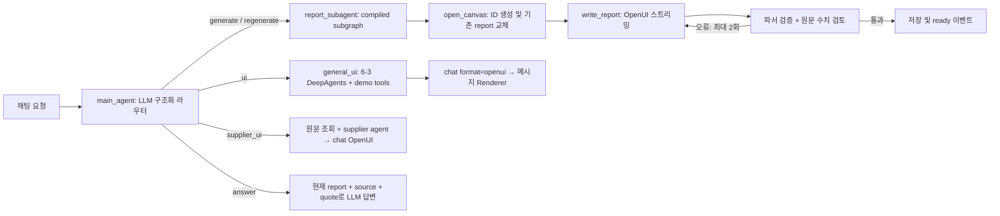

# Lite Canvas UX 시스템 설계

## LCU-101 실행과 경계

- 백엔드: Python 3.12, LangGraph 1.2.16 / API 0.16.1, uv. 포트 2040.
- 프런트엔드: Next.js 16.1.6 / React 19.2.3, npm. 포트 3048.
- 두 프로젝트는 HTTP로만 통신한다. 런타임에 형제 프로젝트나 서로의 파일을 읽지 않는다.
- `OPENAI_API_KEY`, `OPENAI_MODEL`, `OPENAI_REPORT_MODEL`, `OPENAI_REVIEW_MODEL`은 backend-langgraph/.env에서 관리한다. 기본 메인/일반 텍스트 및 범용 UI 모델(`OPENAI_UI_MODEL`)은 gpt-4.1-mini, 리포트 생성과 공급업체 UI 분석은 `OPENAI_REPORT_MODEL`(기본 gpt-5.4), 수치 검토는 gpt-5.4-mini이다. GPT-5 계열 reasoning effort 기본값은 low이며 환경변수로 조정할 수 있다.
- frontend/.env의 `LANGGRAPH_API_URL=http://127.0.0.1:2040`, `LANGGRAPH_ASSISTANT_ID=agent`. 배포 인증은 선택적 `LANGSMITH_API_KEY`다.
- 양쪽 `.env`는 Git 제외. `.venv`, node_modules, 빌드/실행 캐시도 제외한다.

## LCU-102 에이전트 실행

`agent/graph.py`의 StateGraph:

정규식 키워드 분기만으로 메인 에이전트를 대체하지 않는다. LLM의 구조화된 `RouteDecision`을 조건부 edge에 사용한다. 공급업체 카탈로그는 정확한 이름/ID로 조회한다. 없는 공급업체 요청은 기존 리포트를 보존하며 안내한다.

LangGraph 입력은 `messages`, `quote`뿐이다. `report`, `source`, `supplier_context`, `decision`, `routing_error`는 서버가 결정한다. 인용 질문은 report ID가 현재 리포트와 일치하고 ready일 때만 처리한다. 리포트 프로그램과 원문이 checkpoint 상태에 포함되어 후속 LLM 호출의 근거가 된다.

## LCU-103 이벤트와 프런트엔드

`frontend/src/app/api/chat/route.ts`는 UUID thread를 생성/재사용하고 `/threads/{id}/runs/stream`을 호출한다. `stream_mode=[custom]`, `stream_subgraphs=true`, `multitask_strategy=reject`, `on_disconnect=continue`를 사용한다.

| 채널 | 이벤트 | 효과 |
|---|---|---|
| run | routed / error | 라우팅 상태/실패 표시 |
| canvas | open | 새 report ID와 빈 Canvas로 교체 |
| canvas | TEXT_MESSAGE_START | 새 생성/수정 시 프로그램 버퍼 초기화 |
| canvas | TEXT_MESSAGE_CONTENT | OpenUI Lang delta 누적 |
| canvas | validating / reviewing / repairing | 검증/원문 대조/수정 상태 |
| canvas | TEXT_MESSAGE_END / ready | 최종 프로그램과 저장 상태 반영 |
| canvas | error | 오류 표시, 발행/인쇄 비활성화 |
| chat | TEXT_MESSAGE_START/CONTENT/END 또는 message | 채팅 답변 표시 |

SSE 이벤트 이름은 `custom` 또는 `custom|report_subagent:...`이고 JSON payload의 `channel`로 구분한다. 텍스트 수명주기는 AG-UI 이름을 사용하지만 전체 transport는 애플리케이션 custom 계약이다. OpenUI 호환성의 핵심은 누적된 Lang 프로그램을 `@openuidev/react-lang` Renderer에 전달하는 것이다.

`src/canvas/stream.ts`는 UTF-8/CRLF/분할 frame을 처리한다. `state.ts` reducer는 이전 report ID의 늦은 delta를 무시한다. `workspace.tsx`는 thread별 채팅·리포트 UI와 인용을 관리한다. `report-view.tsx`는 편집 Canvas와 공개 화면이 공유하는 Renderer/인쇄/발행 UI다.

## LCU-104 데이터와 저장

`agent/data/vendors/*.md`는 test-set에서 복사한 8개 원문이다. 패키지 자산이므로 backend만 설치해도 조회할 수 있다. `source_tables`/`report_facts`는 Markdown 표의 escaped pipe를 보존하여 KPI·캠페인·리스크·조치 배열을 추출한다. `facts_program`이 `root = Col([report])`와 `sourceKpis/sourceCampaigns/sourceRisks/sourceActions` 선언을 서버에서 만든다. 모델은 `report = Col(...)`부터 시작하는 뷰를 생성하며 source 배열을 다시 선언할 수 없다. 데이터 키는 ASCII이고 값은 원문 그대로다. `kpi_comparisons`는 첫 KPI 표의 W1/W2 계산과 원문 변화 주장을 나란히 만들어 생성 문맥에 전달한다.

이 데이터 선언도 Canvas 채널로 먼저 전송한다. AI는 제공된 데이터를 Filter/Each 등으로 조회하며 시각화/설명/레이아웃을 결정한다. 새 숫자 데이터 객체의 임의 작성을 검사하여 모델이 원문을 다시 입력하면서 값을 바꾸는 문제를 줄인다.

`agent/reports.py`의 SQLite 저장소는 `.data/reports.sqlite3`를 사용한다(`REPORT_DB_PATH`로 테스트 격리 가능). `thread_id UNIQUE`가 thread당 하나의 report를 보장한다. 교체는 한 트랜잭션에서 삭제/삽입한다. 모델이 ID를 만들지 않으며 서버 UUID를 사용한다. 늦은 저장은 현재 ID와 일치할 때만 가능하다.

LangGraph 개발 서버의 checkpoint는 `.langgraph_api`에 보관된다. SQLite report에는 ID, thread ID, 원문, 프로그램, 상태, 발행 여부를 저장한다. API 응답은 원문과 thread ID를 제외한다. 브라우저의 `lite-canvas:threads:v1`에는 대화 목록/메시지/인용만 보관한다. 기존 6-3 localStorage 키와 분리한다. 생성 중 새로고침한 경우 서버의 현재 리포트를 2초 간격으로 조회해 완료 상태를 복원한다.

## LCU-105 OpenUI 계약과 검증

카탈로그는 `src/lib/library.ts`, 생성 진입점은 `src/library.ts`다. `npm run generate` 후 `src/generated/system-prompt.txt`를 backend `agent/system-prompt.txt`에 명시적으로 동기화하고 백엔드를 재시작한다.

백엔드는 `OPENUI_VALIDATOR_URL`(기본 `http://127.0.0.1:3048/api/program/validate`)로 최종 프로그램을 보낸다. 프런트엔드 파서가 문법/미해결 참조를 검사하고, ASCII 데이터 키, 세 개 이상의 차트, 두 개 이하 상세 표를 검사한다. 인터랙티브 모드는 state-bound 선택기를 요구하고 PDF 모드는 정적 컴포넌트만 허용한다(LCU-110). 검토 결과에는 원문과 생성 뷰에서 각각 정확히 인용한 증거가 필요하다. 원문 주장과 계산값의 의도적인 병기는 생성 오류로 취급하지 않는다. 생성 모델은 원문 대조 검토 결과를 받아 최대 두 번 전체 프로그램을 수정한다. 검토는 확률적이며 모든 사실/표현 오류의 부재를 보증하지 않는다. 실제 브라우저 렌더링/필터 결과는 별도 E2E로 확인한다.

공급업체/캠페인 ID의 `_`를 Markdown 강조로 해석하지 않도록 inline Markdown 경계를 보완했다. 한국어는 화면 라벨 값으로 사용하고 데이터 필드명은 ASCII로 생성한다.

## LCU-106 조회·발행·인쇄

백엔드 custom Starlette 앱(`langgraph.json`의 `http.app`)은 다음 경로를 제공한다.

- `GET /canvas/vendors`: 공급업체 카탈로그.
- `GET /canvas/threads/{threadId}/report`: 현재 리포트 메타데이터/프로그램.
- `POST /canvas/reports/{reportId}/publish`: ready 상태만 발행.
- `GET /canvas/reports/{reportId}`: 발행된 ready 리포트만 조회.

Next.js는 명시적인 API route로 프록시한다. `/reports/{reportId}`는 서버에서 공개 리포트를 조회해 공통 클라이언트 Renderer로 표시한다. 생성 중/실패/미발행/교체된 report는 공개 조회가 불가능하다. 인쇄 CSS는 본문만 A4로 출력하며 PDF는 브라우저 인쇄 엔진을 사용한다. SVG viewBox와 인쇄 CSS로 차트를 카드 너비에 맞추고 표 셀을 줄바꿈한다. 표를 포함한 grid는 한 열로 인쇄하고, 웹 보조 파일명 footer는 인쇄에서 제외한다.

## 검증 기준과 제한

단위 테스트, 정적 검사, 실제 provider/SSE, 브라우저, PDF를 별도 증거로 기록한다. 실제 실행 결과는 [구현·검증 기록](../flow/2026-10-20-implementation-summary.md#canvas)을 따른다. 복사된 2026-10-18 flow와 bootstrap 기록은 원본 이력이며 현재 구현의 실행 증거로 사용하지 않는다.

참고 API: [LangGraph custom streaming](https://reference.langchain.com/python/langgraph/config/get_stream_writer), [custom HTTP routes](https://docs.langchain.com/langsmith/custom-routes).

## LCU-107 화면 스타일

6-3과 같은 `@openuidev/react-ui/styles/index.css`의 OpenUI 테마 토큰을 앱 전체에 사용한다. `workspace.css`의 사이드바·채팅·Canvas 외곽은 중립색 배경/텍스트/테두리를 참조하며 별도 녹색·베이지 팔레트를 사용하지 않는다. 입력창은 6-3 AgentInterface의 여백, 둥근 모서리, 그림자, 15px 글자와 원형 전송 버튼 스타일을 따른다. Canvas 분할 및 인쇄 레이아웃은 6-b-3 전용이다.

테마 토글은 채팅 헤더와 공개 리포트 툴바에 표시한다. `WorkspaceTheme`이 OpenUI `useThemeModePreference`를 사용하고 `lite-canvas:theme`에 선택을 저장한다. 처음에는 OS 테마를 따르며 선택 이후 새로고침·페이지 이동에도 유지한다. 인쇄 중에는 루트 테마를 light로 전환하고 종료 후 원래 테마로 복원하며 저장된 선택은 바꾸지 않는다.

## LCU-108 범용 UI 실행 및 채팅 렌더링

`RouteDecision.action=ui`는 공급업체 리포트 외의 일반 UI 요청과 후속 변경을 `general_ui`로 보낸다. `agent/general_ui.py`는 6-3과 같은 `create_deep_agent`, 생성 카탈로그 프롬프트 및 get_weather/get_stock_price/search_web 데모 도구를 사용한다. 원래 6-3의 전체 transport를 복제하는 대신 현재 custom SSE 채팅 채널에 생성 결과를 연결했다.

`chat/TEXT_MESSAGE_START`의 `format=openui`로 메시지 종류를 지정하고 delta와 END로 완성한다. 검증 오류는 최대 두 번 전체 재생성하며 같은 message ID의 START가 버퍼를 초기화한다. 실패는 UI_ERROR로 표시한다. 일반 UI 검증은 기존 parser/미해결 참조 검사를 사용하며 리포트의 차트 개수·표 개수·필터 의무 규칙은 적용하지 않는다.

`ChatUI`가 동일 카탈로그 Renderer로 메시지를 표시한다. `reduceChat`이 형식·완료·오류 상태를 관리한다. ToAssistant의 폼 상태/문맥은 `buildMessage`로 서버 입력에 담고 화면에는 사용자용 질문만 표시한다. OpenUrl은 http/https만 허용한다. CopyToClipboard 및 로컬 상태 액션도 유지한다. 일반 UI 요청은 report 저장소를 수정하지 않는다.

## LCU-109 Canvas splitter

`CanvasSplitter`는 Pointer Events와 pointer capture로 마우스/터치 드래그를 처리한다. Grid의 `--chat-width`/`--chat-height`를 변경하고 ResizeObserver로 창 크기를 반영한다. 데스크톱 최소 폭은 채팅 300px/Canvas 320px, 모바일 높이는 채팅 180px(작은 창에서는 전체의 1/3 이하)/Canvas 240px 기준이다. 조절 완료 시 `lite-canvas:split-size`에 저장한다. separator의 방향·현재값·범위를 ARIA로 제공하고 키보드, 포인터 취소, 더블클릭 초기화도 지원한다. Canvas를 닫거나 인쇄할 때 구분선을 표시하지 않는다.

## LCU-110 리포트 모드와 공급업체 UI 경로

`RouteDecision`은 `action` 외에 `report_mode=interactive|pdf|inherit`를 구조화 출력한다. 서버는 새 생성의 inherit를 interactive로, 재생성의 inherit를 현재 모드로 정규화한다. SQLite JSON report와 공개 DTO의 `report_mode`를 Canvas open/ready와 공유 화면까지 전달한다. 기존 필드 없는 리포트는 interactive로 취급한다.

`write_report`는 모드별 프롬프트와 검증기를 선택한다. `api/program/validate`의 pdf 모드는 기존 파서·차트/표 개수 검사와 함께 정적 컴포넌트 허용 목록을 적용하고 `$state`, 입력·탭·팝오버·액션·동적 조회를 거부한다. interactive/report 모드의 state-bound 선택기 요구는 유지한다. PDF 핵심 값의 가시성과 레이아웃은 생성 지침 및 실제 브라우저/PDF 검증으로 확인하며 정적 검증만으로 의미적 완전성을 보증하지 않는다.

`action=supplier_ui`는 공급업체 원문 조회 후 `general_ui` 노드 안의 도구 없는 supplier agent에서 모델을 직접 스트리밍한다. 매 수정 시 독립 모델 호출을 사용하며 외부 데모 도구를 제공하지 않는다. Server declarations의 `root=Col([answer])`, source 배열 뒤에 모델이 answer 뷰만 생성한다. 원문·파일명·계산 감사·인용과 동일 업체의 현재 리포트를 모델 문맥에 제공한다. 파서, source 재선언/숫자 객체 검사, 별도 원문 수치 검토 후 최대 2회 수정한다. 실패는 chat UI_ERROR이며 report 저장소를 변경하지 않는다.

서버 상태 `supplier_context`는 마지막 조회 원문을 보관해 후속 질문에 사용한다. `source`는 매 요청 라우팅 때 재설정한다. 클라이언트 입력 스키마는 여전히 messages/quote만 허용한다. 일반 ui는 기존 범용 agent/데모 도구를 사용하고 공급업체 질문의 데이터 문맥과 분리된다.

PDF 모드의 인쇄 표는 자동 열 너비와 좁은 셀 여백을 사용하고 숫자 셀 줄바꿈을 막는다. 중첩 카드는 페이지 사이에서 나눌 수 있게 하되 개별 카드/표 행의 분할은 억제한다. 현재 검증 증거는 [PDF·공급업체 UI 검증](../flow/2026-10-20-implementation-summary.md#pdf)에 기록한다.

## LCU-111 첫 질문 템플릿

`workspace.tsx`의 `STARTER_GROUPS`가 빈 대화의 추천 질문 15개를 관리한다. 네이티브 details/summary로 그룹을 펼치고 기존 send 경로로 질문을 전달한다. 실행 중/초기 상태 복원 중에는 버튼을 비활성화한다.

## LCU-112 원문 파일명 익명화

원문 파일명은 `supplier-01_analysis_20261001_20261014_ko.md`~`supplier-08_analysis_20261001_20261014_ko.md`로 통일한다. 파일 번호는 본문의 공급업체 번호와 일치한다. 카탈로그 ID도 파일명에서 추출한 `supplier-01`~`supplier-08`을 사용하며 기존 실제 공급업체 코드로 조회하지 않는다. 신규 응답/리포트의 source_file에는 익명 파일명이 전달된다. 이미 저장된 리포트·대화·PDF는 과거 스냅샷이므로 자동으로 다시 작성하지 않는다.

## LCU-113 차트 해석 생성 지침

`general_ui.py`의 `CHART_NARRATIVE_INSTRUCTIONS`를 범용 UI, 공급업체 답변, `graph.py`의 모드별 report_instructions에 공통 적용한다. 차트와 동일 섹션에 읽을 수 있는 Text 해석을 배치하고 단순 숫자/범례/배지 나열과 구분한다. 필터가 있으면 선택 데이터와 해석을 일치시키거나 전체 데이터 해석임을 명시한다. PDF에는 항상 보이는 문단을 생성한다. 의미적 해석 품질은 생성 지침과 실제 결과 확인으로 검증하며 정적 parser 검사만으로 보증하지 않는다.

리포트 생성 지침은 UI와 서술에 같은 비중을 둔다. 짧은 도입 뒤 KPI Grid, 핵심 차트와 바로 아래 해석, 필요한 비교 Table, 우선순위 Card/Badge를 사용한다. PDF 모드도 정적 UI 구성을 유지한다. KPI/차트 권장 개수는 생성 지침이며 기존 파서 검증 규칙은 변경하지 않는다.

원문 내 잔여 캠페인명과 추천 서비스 표기는 샘플 명칭으로 대체하고, 추천 링크는 내부 주소와 쿼리를 제거한 `https://example.invalid/` 예시 링크로 제공한다. 수치 데이터는 이 치환에서 변경하지 않았으므로 전체 원문이 합성 데이터라는 의미는 아니다.

상품명·옵션명은 `샘플상품NNNN`, 캠페인명은 `샘플캠페인NNN`으로 통일한다. 표·요약·진단·추천·연결 캠페인에 동일 ID 기반 이름을 사용하고, 잔여 숫자형 실제 ID는 충돌 없는 VID_/CAMP_ ID로 치환한다. 분석 수치·기간·표 구조는 유지하며 원래 이름/ID 대응표는 저장소에 남기지 않는다. 공급업체명은 카탈로그 조회를 위해 명시적으로 유지한다.

## LCU-114 FBA 스타일 물류 데모

8개 공급업체 원문은 아마존 마켓플레이스/FBA 물류를 가정한다. 원문 도입에 FBA·풀필먼트 센터(FC), OOS(재고 품절), BBL(추천 오퍼 미확보)의 의미를 명시하고 본문의 재고 보충/구매 박스 용어를 FBA 재고 보충/추천 오퍼로 통일한다. VID_/CAMP_는 내부 샘플 ID이며 광고 유형과 목표 광고수익률 규칙은 실제 Amazon Ads 기능의 복제가 아니다. 분석 수치·통화·기간·표 구조는 보존한다. 과거 저장 리포트/checkpoint는 자동 변환하지 않는다. 용어 기준: [Amazon FBA](https://sell.amazon.com/fulfill.html).

## LCU-115 컴포넌트 갤러리

`/gallery`는 개발/production 모두에서 수동 작성 OpenUI 예제를 표시한다. `?theme=dark`로 다크 테마를 선택한다. production 제한을 제거했으며 기존 실행 서버에 반영하려면 재빌드·재시작해야 한다.

## LCU-111 핵심 코드의 한국어 주석과 읽기 순서

주요 실행 경계에는 동작의 이유와 상태 소유권을 설명하는 한국어 주석을 둔다. 카탈로그와 모델 프롬프트의 실제 계약 문자열은 유지한다.

1. `frontend/src/canvas/workspace.tsx` → `frontend/src/app/api/chat/route.ts`: 사용자 입력, thread별 상태, 서버 실행 요청.
2. `backend-langgraph/agent/graph.py`: 라우팅, 인용 유효성, 리포트 서브그래프, 생성·검증·수정.
3. `backend-langgraph/agent/reports.py` → `agent/http.py`: 원문 배열과 계산값, thread당 하나의 리포트 저장, 발행·공개 조회.
4. `backend-langgraph/agent/general_ui.py`: 범용 UI와 공급업체 답변의 분리, 채팅 UI 수정 루프.
5. `frontend/src/canvas/stream.ts` → `state.ts` → `workspace.tsx`: SSE 프레임 복원, ID별 이벤트 반영, 재접속 후 서버 상태 조회.
6. `frontend/src/canvas/report-view.tsx`, `chat-ui.tsx`, `splitter.tsx`, `theme.tsx`: 렌더링, 인용·발행·인쇄, 액션, 분할 크기, 인쇄 테마 복원.
7. `frontend/src/lib/library.ts` → `frontend/src/app/api/program/validate/route.ts`: 공유 카탈로그와 모드별 검증. `frontend/src/server/backend.ts`는 서버 전용 HTTP 연결 경계다.

주석 추가와 검증 근거: [한국어 주석 기록](../flow/2026-10-20-korean-code-comments.md).

## LCU-116 리포트 언어 상태

`RouteDecision.report_language=ko|en|inherit`를 추가한다. 새 생성의 inherit는 ko, 재생성의 inherit는 현재 리포트 언어(기존 저장본은 ko)로 정규화한다. `ReportRepository.replace`는 ko/en만 허용하고 영어 제목과 `report_language`를 JSON에 저장한다. Open/ready 이벤트·공개 DTO·복원은 같은 필드를 전달한다.

`report_instructions(mode, language)`는 언어별 지침을 모드별 지침 뒤에 적용한다. 영어 리포트는 원문에서 추출한 배열의 한국어 문자열만 구조화 출력으로 번역해 표시용 배열을 만든다. 숫자 토큰(부호/소수 포함)을 임시 표식으로 보호한 뒤 번역하고 원래 값을 복원한다. 문자열 개수·한국어 잔류·표식 누락/중복·새 숫자 삽입을 검사하고 실패 시 한 번 재시도한다. 계산용 숫자 필드와 저장 원문은 변경하지 않는다. 번역된 배열을 immutable source 선언으로 제공하므로 카드·차트·필터·조치에 동일한 영어 표현을 사용한다. 원문과 계산 감사는 별도 문맥으로 유지한다. 원문 수치 검토와 parser 검증은 기존대로 유지한다. `ReportView`는 본문 lang과 출처 footer를 리포트 언어에 맞춘다. 컴포넌트 카탈로그 계약은 변경하지 않는다.

## LCU-PATH-001 정식 프로젝트 경로

정식 경로는 `21-mini-projects/6-openui-poc/6-b-3-lite-canvas-ux/`다. 구 `6-7-lite-canvas-ux`의 소스·설정을 이 경로로 통합하고 빈 구 디렉터리를 제거했다. 포트 2040/3048 및 기능 계약은 유지하며 기존 저장 리포트·환경 파일·런타임 상태를 보존한다. [복구 기록](../flow/2026-10-26-path-recovery.md)을 참조한다.
