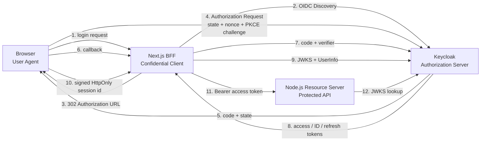

# OAuth 2.0 & OpenID Connect Interactive Lab

Authorization Code + PKCE와 OpenID Connect를 실제 HTTP 통신으로 실행하고 관찰하는 풀스택 학습 프로젝트입니다. Phase 1 MVP는 Next.js BFF, Keycloak, 별도 Resource Server, 서버 측 token 보관, 실측 Protocol Trace, 401/403 비교를 제공합니다.

## 바로 실행하기

필수 도구: Docker Desktop 또는 Docker Engine + Compose v2

```bash
cd 21-mini-projects/8-oauth-oidc-lab
pnpm install
pnpm up
```

서비스가 healthy가 되면 다음 주소를 엽니다.

- Protocol Explorer: http://localhost:3000
- Keycloak: http://localhost:8180
- Keycloak Admin Console: http://localhost:8180/admin (`admin` / `admin`)
- Resource Server health: http://localhost:4000/health

테스트 계정:

| 목적 | Username | Password | Realm roles |
| --- | --- | --- | --- |
| 403 비교용 일반 학습자 | `learner` | `learner` | `lab-user` |
| 관리자 성공 비교용 | `admin-learner` | `admin-learner` | `lab-user`, `lab-admin` |

컨테이너를 종료하거나 realm을 초기 상태로 다시 만들려면 다음 명령을 사용합니다.

```bash
pnpm down
pnpm reset
```

`reset`은 이 Compose 프로젝트의 컨테이너와 볼륨만 제거합니다.

## 아키텍처



구성요소의 책임은 분리되어 있습니다.

- `apps/web`: App Router UI, BFF route handlers, OAuth/OIDC 프로토콜, 서버 세션, trace 수집.
- `apps/resource-server`: access token의 signature, issuer, audience, expiry, scope, realm role 검증.
- `keycloak/oauth-lab-realm.json`: realm, confidential client, audience/scope mapper, 사용자와 역할의 재현 가능한 import.
- `docs/stock`: 현재 학습·시스템 설계의 기준 문서.
- `docs/flow`: 날짜별 결정과 검증 이력.

## 구현된 Phase 1 기능

- Authorization URL 직접 생성
- 256-bit `state`, `nonce`, PKCE `code_verifier` 생성
- SHA-256 기반 `code_challenge` (`S256`)
- callback의 state 및 transaction expiry 검증
- confidential client의 Authorization Code 교환
- OIDC Discovery metadata 조회 및 issuer 일치 검증
- Keycloak JWKS 조회와 `jose` 기반 RS256 검증
- ID Token의 issuer, audience, expiry, nonce 검증
- Access Token의 issuer, resource audience, expiry 검증
- UserInfo 호출 및 ID Token `sub`와의 대조
- 서버 측 access/ID/refresh token 저장과 refresh grant
- RP-Initiated Logout
- Resource Server의 `resource.read` scope와 `lab-admin` role 인가
- 인증 실패 401과 권한 부족 403 분리
- 실제 HTTP request/response 기반 trace와 JWT claim Inspector
- 잘못된 PKCE verifier를 보내는 실제 실패 실습

## Protocol Explorer 사용법

1. `OIDC 로그인 시작`을 누르고 `learner / learner`로 로그인합니다.
2. 중앙 Timeline에서 Discovery → Authorization redirect → callback → Token → JWKS → UserInfo 단계를 선택합니다.
3. 오른쪽 Inspector에서 method, URL, headers, body, status, claims와 설명을 비교합니다.
4. `사용자 API 호출`은 200을, `관리자 API 호출`은 인증된 일반 사용자에게 403을 반환합니다.
5. `Token 갱신`으로 refresh grant를 관찰합니다.
6. 로그아웃 후 `잘못된 PKCE 실습`을 실행하면 Token Endpoint의 `invalid_grant` 응답을 확인할 수 있습니다.

Trace의 evidence 표시는 의미가 다릅니다.

- `observed`: BFF가 실제로 받은 요청/응답 또는 직접 수행한 `fetch`.
- `reconstructed`: BFF가 직접 볼 수 없는 브라우저 redirect를 실제 Location/callback 데이터로 재구성.
- `local-validation`: `jose`로 수행한 로컬 암호학적 검증.

## OAuth와 OIDC 비교

| 구분 | OAuth 2.0 | OpenID Connect |
| --- | --- | --- |
| 주 목적 | API 접근 위임 | 사용자 인증 |
| 주요 결과 | Access Token | ID Token + 인증 세션 |
| 대상 | Resource Server | Client / Relying Party |
| 이 Lab의 관찰 지점 | scope, audience, 401/403 | `openid`, nonce, ID Token, UserInfo, Discovery |

## 보안 설계

- 브라우저에는 token, code, verifier, client secret을 전달하지 않습니다.
- token set은 BFF의 서버 메모리에만 저장합니다.
- 쿠키에는 HMAC으로 서명한 256-bit 난수 session id만 저장합니다.
- 쿠키는 `HttpOnly`, `SameSite=Lax`, `Path=/api`이며 HTTPS 환경에서는 `Secure`가 활성화됩니다.
- Trace는 저장 전에 code/state/nonce/token/cookie/Authorization 값을 서버에서 완전히 마스킹합니다.
- callback은 state 검증 전에는 Token Endpoint를 호출하지 않습니다.
- refresh와 Resource API POST는 요청 Origin을 검사합니다.
- Resource Server는 BFF의 판단을 신뢰하지 않고 JWT를 독립 검증합니다.

로컬 기본 secret과 HTTP는 학습 전용입니다. 운영에서는 HTTPS, secret manager, 중앙 암호화 세션 저장소, key rotation, audit retention 정책이 필요합니다.

## 로컬 앱 개발 모드

Keycloak만 Docker로 실행하고 Node 앱은 호스트에서 hot reload할 수 있습니다.

터미널 1:

```bash
pnpm dev:infra
```

터미널 2:

```bash
pnpm dev
```

기본값을 변경할 때는 [.env.example](.env.example)을 참고해 shell 환경 변수 또는 앱별 `.env.local`을 설정합니다. Docker 내부 통신에서는 public issuer와 internal endpoint 주소가 다르므로 `KEYCLOAK_PUBLIC_URL`과 `KEYCLOAK_INTERNAL_URL`을 분리했습니다.

## 검증 명령

```bash
pnpm typecheck
pnpm lint
pnpm test
pnpm build
pnpm test:e2e
```

최초 한 번 Playwright Chromium이 필요합니다.

```bash
pnpm exec playwright install chromium
```

Docker 기반 전체 프로토콜 E2E:

```bash
pnpm up
pnpm test:e2e:full
```

전체 E2E는 실제 Keycloak 로그인, code + PKCE 교환, refresh, API 200/403, 로컬 세션 초기화 후 SSO, logout, 잘못된 PKCE 400, 변조된 state에서 token endpoint 미호출을 검증합니다.

## 알려진 제약사항

- BFF 세션과 Trace는 프로세스 메모리에 저장되므로 재시작 시 사라지고 다중 replica를 지원하지 않습니다.
- Keycloak은 H2와 `start-dev`를 사용하며 운영 배포 구성이 아닙니다.
- Access Token은 Keycloak JWT만 다루며 opaque token introspection 비교는 아직 없습니다.
- Trace는 BFF 경계의 실측값 중심이며 브라우저와 Keycloak 사이 응답은 명시적으로 `reconstructed`입니다.
- ID Token `at_hash`, refresh rotation/reuse detection, revocation, back-channel logout은 Phase 2/3 범위입니다.
- 전체 9개 Chapter 중 Phase 1에 필요한 Chapter 3/4/5/7과 token refresh 일부만 실행형 실습입니다.

## Phase 2 계획

- Concept → Prediction → Execution → Inspection → Explanation → Verification 단계 UX
- OAuth-only와 OIDC 요청의 나란한 비교
- JWT header/payload/signature 전용 Decoder와 claim 검증 체크리스트
- 단계별 퀴즈, 성공 조건, 진행률 저장
- access/refresh 만료 시간 조절과 rotation/revocation 시각화
- 401/403/audience/scope/role 실패를 UI에서 선택하는 scenario runner
- 브라우저 client event와 server trace의 더 정밀한 시간축 결합
- 접근성 및 모바일 다이어그램 개선

## 표준과 공식 자료

- [OAuth 2.0 — RFC 6749](https://www.rfc-editor.org/rfc/rfc6749)
- [PKCE — RFC 7636](https://www.rfc-editor.org/rfc/rfc7636)
- [OAuth 2.0 Security BCP — RFC 9700](https://www.rfc-editor.org/rfc/rfc9700)
- [OpenID Connect Core 1.0](https://openid.net/specs/openid-connect-core-1_0.html)
- [OpenID Connect Discovery 1.0](https://openid.net/specs/openid-connect-discovery-1_0.html)
- [Keycloak OIDC endpoints](https://www.keycloak.org/securing-apps/oidc-layers)
- [Keycloak container realm import](https://www.keycloak.org/server/containers)
- [`jose` documentation](https://github.com/panva/jose/tree/main/docs)

세부 설계는 [문서 지도](docs/README.md)에서 확인합니다.
