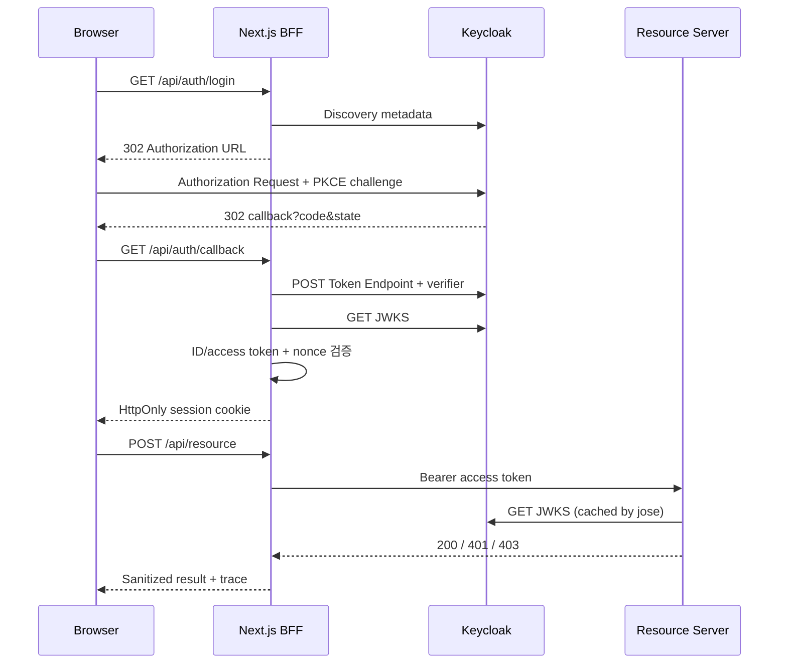

# OAuth 2.0 & OpenID Connect Interactive Lab — 시스템 설계

상태: Phase 1 MVP 기준  
최종 동기화: 2026-11-02

## 구성요소

## 디렉터리 경계

- `apps/web`: UI, BFF route handlers, 인증 도메인, 서버 세션, protocol trace.
- `apps/resource-server`: access token 검증과 scope/role 기반 API.
- `keycloak`: 재현 가능한 realm import.
- `docs/stock`: 최신 학습·시스템 설계.
- `docs/flow`: append-only 구현 및 검증 기록.

## 보안 경계

- 브라우저 쿠키에는 256-bit 난수 세션 식별자만 저장한다.
- 세션 쿠키는 `HttpOnly`, `SameSite=Lax`, `Path=/api`이며 `Secure`는 운영/HTTPS에서 강제한다.
- client secret, authorization code, verifier, access/ID/refresh token은 BFF 메모리 경계를 벗어나지 않는다.
- callback은 code 교환 전에 state와 만료 시간을 검증한다.
- ID token은 RS256 signature, issuer, audience, expiry 및 nonce를 검증한다.
- access token은 Resource Server가 signature, issuer, `oauth-lab-resource` audience, expiry를 독립 검증한다.
- 인증 실패는 401, 인증 후 권한 부족은 403으로 분리한다.
- state 변경, refresh, resource 호출 같은 mutation API는 same-origin 검사를 수행한다.

## Trace 모델

각 단계는 `traceId`, `stepId`, `timestamp`, `source`, `destination`, `method`, `url`, `request`, `response`, `duration`, `explanation`, `observation`을 갖는다. 네트워크 호출은 응답을 받은 뒤 측정값으로 기록한다. 서버가 직접 볼 수 없는 브라우저→Keycloak 이동은 `reconstructed`로 기록한다.

Trace 저장 전 재귀 마스킹을 적용한다. Authorization/Cookie 헤더 및 이름이 `code`, `token`, `secret`, `verifier`, `cookie`인 필드는 원문을 저장하지 않는다.

## 런타임 제약

세션과 trace는 프로세스 메모리에 저장되므로 재시작 시 사라지고 수평 확장되지 않는다. 운영 전환 시 암호화된 중앙 세션 저장소, TLS, 비밀 관리 시스템, audit retention 정책이 필요하다.

## 표준 근거

- OAuth 2.0: RFC 6749
- PKCE: RFC 7636
- OpenID Connect Core 1.0 및 Discovery 1.0
- JWT/JWK: RFC 7519 / RFC 7517
- OAuth 2.0 Security Best Current Practice: RFC 9700
